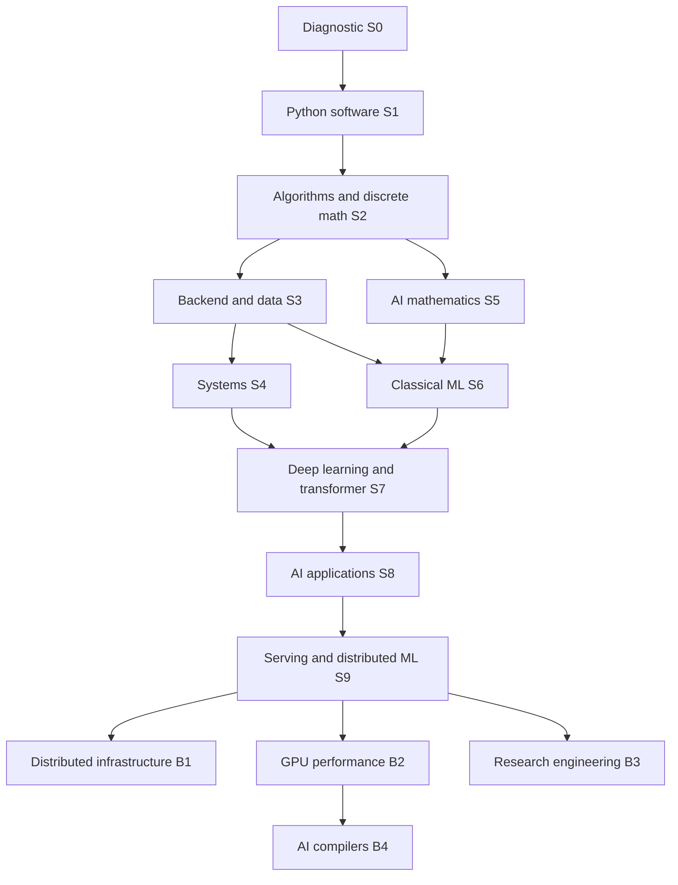

# Elite AI Engineering — Curriculum and execution system

Prepared October 20, 2026 for a learner with basic Python, Linux familiarity, mathematical aptitude and five study hours per week.

**Recommended path:** backend and data engineering first, then ML systems and inference. Begin applying after demonstrated backend competence; do not wait for the entire advanced curriculum. The base plan is 1,520 hours (304 active weeks), with the first backend checkpoint at 440 hours. At 46 active weeks annually these are about 6.6 and 1.9 years. Optional specializations and professional experience follow; no completion date implies seniority or guaranteed employment.

The twelve deliverables follow in the requested order. [Ready-to-use repository](ai-engineering-curriculum/README.md) · [All weekly assignments](ai-engineering-curriculum/docs/weekly-assignments.md) · [Current first action](ai-engineering-curriculum/NOW.md).

This document is a snapshot. `ai-engineering-curriculum/curriculum.json` controls prerequisites, hours and weekly criteria. All initial research/resource checks are dated October 20, 2026; salary examples are not earnings forecasts.


---

# 1. Career competency analysis

Research snapshot: October 20, 2026. This is a curriculum designer's synthesis of public evidence, not a claim that representatives of these companies participated. US postings are used for compensation examples because the requested employers publish them; eligibility, location, openings and packages change. The sample is selective and cannot establish hiring probabilities or market-wide medians.

## Recommendation

Start with **Python backend and data engineering**, seek work once you can maintain a deployed service, then specialize in **ML systems, evaluation and inference**. This gives you useful software skills before the much longer mathematical and research sequence. Your Linux familiarity reduces tool-learning overhead; it does not substitute for application design, testing or systems internals. RNtoNP can supply a meaningful directory/data problem and Simpyll can present the evidence. Neither is required: a public-library or open-course directory works equally well.

This is a judgment about option value and prerequisite overlap, not a verified claim that one track has the highest expected earnings. A narrow GPU or research-scientist path would postpone your earliest employable work substantially. Reconsider after actual systems and ML projects reveal what you enjoy and perform well at.

## What the postings establish

- Google's sampled **Staff Software Engineer, BigQuery ML** posting requires eight years in software development, substantial launch/design experience, and five years of ML infrastructure experience. It lists US base salary of **$207,000–$301,000**, a **20% bonus target**, equity and benefits. This illustrates why a portfolio is not a substitute for a Staff history. [Google posting](https://www.google.com/about/careers/applications/jobs/results/135262336041525958-staff-software-engineer-bigquery-machine-learning)
- OpenAI's **Research Engineer** posting emphasizes programming and large distributed systems, with high-performance deep-learning implementation as a useful additional qualification. It lists **$250,000–$445,000 base pay**, equity and eligible performance bonuses. It does not make a PhD a stated requirement on this page. [OpenAI posting](https://openai.com/careers/research-engineer-san-francisco/)
- Anthropic's **Performance Engineer, Inference Systems** posting emphasizes profiling, roofline reasoning, production debugging, correctness evaluation, telemetry and written influence. Its posted **Annual Salary is $350,000–$850,000**; the page does not give a quantified total compensation package. That unusually wide range is an exceptional employer/role example, not an attainable starting salary or a typical performance-engineering wage. [Anthropic posting](https://job-boards.greenhouse.io/anthropic/jobs/5224564008)
- Google's sampled **Distinguished Engineer, Product SRE** posting asks for 15 years of software experience, distributed-systems architecture, concurrency and cross-organization influence. This is evidence of scope and history, not a universal tenure rule. [Google posting](https://www.google.com/about/careers/applications/jobs/results/114070756412793542-distinguished-engineer-google-product-site-reliability)
- Google's sampled **Senior AI/ML** role asks for five years of software development experience. Titles vary; do not treat these examples as automatic promotion schedules. [Google posting](https://www.google.com/about/careers/applications/jobs/results/95439503962841798-senior-software-engineer-aiml-gen-ai-geo)
- OpenAI's **Research Scientist** posting asks for original contributions, such as first-author publications or projects, and the ability to pursue a research agenda. DeepMind describes research engineers as combining engineering, mathematics and ML, while research scientists generally bring doctoral-level research preparation. A doctorate is a common route, not a universal legal or technical prerequisite. [OpenAI scientist](https://openai.com/careers/research-scientist-san-francisco/), [DeepMind careers](https://deepmind.google/careers/)

Base salary is cash salary. An offer's annualized total compensation may add target bonus and equity vesting value; sign-on grants, refreshers and liquidity conditions must be separated. Private equity is not equivalent to spendable cash. The sources above do not establish comparable TC medians, so none are invented. Exceptional million-dollar packages sometimes discussed publicly should be treated as outliers, not a curriculum target or a probability estimate. No numerical forecast of your compensation is defensible from these data.

## Competency matrix

H = central hiring evidence; M = supporting competence; L = limited emphasis. These are synthesized priorities, not employer scoring systems. All roles still require communication, collaboration and security judgment.

| Track | Software / algorithms | Systems / reliability | ML / math | Experiments / research | GPU / compiler | Leadership evidence | Accessibility from this profile |
|---|---|---|---|---|---|---|---|
| Senior/Staff software | H | H | L–M | L | L | H | Broadest base; seniority requires shipped outcomes |
| Principal/Distinguished software | H | H | Domain-dependent | M | Domain-dependent | H across organizations | Very long experience path, not a self-study endpoint |
| Senior/Staff ML engineer | H | H | H | H evaluation | M | H | Accessible through software + deployed ML experience |
| AI research engineer | H | H | H | H | M–H | M–H | Difficult; strong implementations and credible experiments |
| Research scientist | M–H | M | H | H original research | Domain-dependent | H intellectual direction | Highest research barrier; doctoral work or equivalent record |
| AI infrastructure | H | H | M | M | M | H at senior levels | Good continuation from backend/systems |
| Distributed systems | H | H | L–M | M measurement | L–M | H | Durable general track; AI domain is optional |
| LLM training/inference | H | H | H | H evaluation | H for some teams | M–H | Strong overlap with recommended later path |
| ML systems performance | H | H | M–H numerics | H measurement | H | H influence | Smaller specialized market; demonstrated bottleneck analysis |
| AI compiler/GPU | H C++ | H architecture | M–H numerics | H benchmarking | H | M–H | Long prerequisite chain; optional focused specialization |

The compiler specialization follows the compiler/GPU skills in NVIDIA's public role materials and its LLVM-based compiler role, but those are not a representative salary sample. [NVIDIA compiler role](https://nvidia.wd5.myworkdayjobs.com/en-US/NVIDIAExternalCareerSite/job/Raytracing-Compiler-Engineer---Developer-and-Performance-Technology_JR2012859)

## Levels of professional scope

| Level | Evidence expected | What self-study can establish | What it cannot establish alone |
|---|---|---|---|
| Entry | Implement scoped changes, tests, Git, debugging, SQL/API basics, ask useful questions | P1–P3, unfamiliar-code exercise, reviewed change | Sustained delivery in a team |
| Strong midlevel | Own a service or feature through design, deployment and operation | P3/P4/P6 and externally reviewed contributions approximate parts | Repeated production responsibility and stakeholder judgment |
| Senior | Resolve ambiguity, make sound trade-offs, mentor, improve reliability | Design reviews and incident simulations rehearse skills | Multi-cycle ownership and real incident leadership |
| Staff | Coordinate architecture and technical direction across teams; measurable leverage | Cross-project work and substantial OSS collaboration provide partial evidence | Organization-level trust, adoption and sustained outcomes |
| Principal/Distinguished | Set broad technical strategy, resolve systemic constraints, grow other technical leaders | Deep specialization and public work can build credibility | Years of consequential, cross-organization decisions |
| Research scientist | Create and validate new knowledge and guide research | Reproduction, rigorous extensions and original papers | Guaranteed novelty, peer recognition, or equivalence to doctoral training |

## Interview implications

Prepare coding, debugging, system design, behavioral examples and, for ML roles, data/evaluation design. Research roles add paper discussions, mathematical reasoning and experiment criticism; performance roles add profiling and architecture reasoning. These are preparation categories, not a promise of a particular interview loop. Meta's official preparation page was rate-limited during verification, so exact current rounds and AI-use rules are deliberately not asserted. Verify the actual interview packet with the recruiter. [Meta preparation page](https://www.metacareers.com/swe-prep-onsite)

Engineering publications reinforce the emphasis on evaluation and realistic workloads: Anthropic discusses task/trial/grader design; PagedAttention studies KV-cache management and serving throughput under explicit experimental settings. The curriculum therefore requires quality checks alongside performance claims. [Anthropic evaluations](https://www.anthropic.com/engineering/demystifying-evals-for-ai-agents), [PagedAttention](https://arxiv.org/abs/2309.06180)


---

# 2. Complete skills dependency graph

The authoritative stage edges are in `curriculum.json`. This human-readable view expands their subskills. F = foundation; A = advanced common-path exposure; O = optional specialization. A stage delivers bounded competence, not mastery of an entire academic discipline.



Default execution is S0→S9 in numerical order. S5 needs S2, so it may move earlier if desired, but moving it changes order rather than creating extra weekly hours. Employability checks after S3 are not contingent on S5–S9. Full AI application competence here follows ML/deep learning deliberately; backend work is the early career route.

| Competency family | Subskills and direct prerequisite chain | Classification | Implementation evidence |
|---|---|---|---|
| Programming | Control flow → functions/collections → exceptions/I/O → modules/types → dataclasses, generators, context managers → packaging | F S1 | P1 parser, collector and release |
| Programming paradigms | Functions/state → procedural decomposition → OO interfaces/composition → functional transformations/immutability; design patterns only for actual repeated problems | F S1; A S3 | Compare three designs, ADR selects one |
| Correctness | Contracts → tests/fixtures → property and integration tests → fault injection; TDD on a parser and regression fix | F throughout | P1–P13 test evidence |
| Algorithms | Discrete logic, proofs/induction → arrays/maps → sorting/search → trees/heaps → graphs → dynamic programming; asymptotic bounds alongside each | F S2 | P2 inverted index, shortest paths, recurrence |
| Architecture/memory | Binary arithmetic → CPU/cache → C pointers/lifetimes → address spaces → concurrency → profiling | F/A S4 | P4 C buffers, queue and CPU/memory experiments |
| OS/Linux | Processes/file descriptors → virtual memory → threads/locks/conditions → crash recovery | F/A S4 | P4 process pipeline and durable log |
| Networks | Byte streams → framing/TCP → DNS/HTTP/TLS → timeouts/backpressure → distributed failure models | F S3–S4; A S9 | P3 raw HTTP inspection; P4 socket server |
| Storage | Relational schemas/SQL → indexes/transactions → WAL and recovery → replication/consistency → storage-engine trade-offs | F S3; A S4/S9; O B1 | P3 migrations and query plans; P10 storage component |
| Backend/cloud | API contracts → authn/authz → container builds → deployment/CI → monitoring/SLOs → backups/incidents; IAM/network/storage introduced before managed orchestration | F S3; A S9; O B1 | P3 service; P10 deployment and outage drills |
| NoSQL/caching | Data access patterns/consistency → key-value cache → eviction/invalidation → document/key-value versus relational trade-off | F S3; A B1 | P3 cache and written SQL/NoSQL decision; no extra database mandatory |
| Security | Input validation → least privilege → authentication/authorization → secrets/dependencies → threat models → prompt injection/tool boundaries | F S1/S3; A S8 | P3 negative tests; P8 adversarial suite |
| Linear algebra | Vectors/matrices → rank/projections → least squares → QR/SVD/eigenvalues → PCA/embedding geometry | F S5 | P5 solvers and PCA |
| Calculus/optimization | Derivatives → multivariable chain rule/Jacobians → gradients → regularization/SGD → neural optimization | F S5; A S7 | P5 finite differences; P7 backprop |
| Probability/statistics | Counting/conditioning → moments/distributions → estimation/uncertainty → experimental design → calibration/causal limits | F S5–S6 | P5 simulations, P6 confidence intervals |
| Numerical/information theory | Floating point/conditioning → stable reductions → entropy/cross-entropy/KL → loss functions/precision trade-offs | F S5; A S7/S9 | P5 stable softmax; P9 quantization quality |
| Classical ML | Data contracts/EDA → split design → regression/classification → trees/ensembles → clustering → feature pipelines/CV → calibration/drift | F S6 | P6 from-scratch models + deployed pipeline |
| Deep learning | Calculus + ML → autograd/MLP → regularization → CNN/RNN survey → embeddings → attention → transformer → small pretraining | A S7 | P7 gradient engine, classifier labs and small LM |
| LLM applications | APIs/data provenance + model evaluation → retrieval/chunking → vector search → grounded generation → structured outputs → bounded tools/agents | A S8 | P8 evidence search and adversarial tests |
| Model adaptation | Training/splits → supervised fine-tuning → LoRA → preference objective/DPO → synthetic-data auditing | A S8; O deeper B3 | P8 small adapter comparison and toy preference loss |
| Inference | Transformer + systems → batching → KV cache → quantization → scheduling → telemetry/capacity | A S9 | P9 inference benchmark and service |
| Distributed training | Concurrency + gradient math → partitioning → collective sum/all-reduce model → DDP → checkpoint recovery; tensor/pipeline model-parallel trade-offs surveyed after DDP | A S9; O B1/B2 deeper | P9 two-process equivalence test and communication model |
| GPU programming | C/memory + numerics → C++/RAII → GPU memory/threads → CUDA → Triton → fusion/profiling → shape-aware tuning | O B2 | P11 kernel suite |
| Compilers | Parsing/AST survey in S4 → C++/GPU competence → type checking/IR → lowering/JIT → legal rewrites | O B4 | P13 differential-tested compiler |
| Research | Evaluation/statistics + paper reading → implementation parity → protocol → replication → uncertainty → ablations → novel extension | O B3; small exposure S7 | P12 reproducibility package |
| Professional influence | Git/reviews/docs → ADRs → stakeholder requirements → trade-off reviews → mentoring/incident reports → cross-team adoption | F throughout; experiential at senior levels | Every project plus external team/OSS evidence |

Additional essential topics include dataset licensing/provenance, accessibility of user-facing outputs, cost accounting, experiment contamination, software supply-chain hygiene, product requirements, ethical data use, and communicating uncertainty. These are embedded in the projects rather than separate courses.

Diagnostics can exempt an individual module only after an unseen implementation, explanation and delayed retention check pass. Strong mathematical aptitude alone earns no exemption. Deep RL, robotics, multimodal foundation-model pretraining, formal verification, custom networking fabrics and production compiler backends are optional later research domains; they are not prerequisites for first employment.


---

# 3. Multiyear curriculum

Generated from `curriculum.json`, the authority for prerequisites, estimates and module criteria. A 20-hour module has four five-hour weeks: reference implementation, application, engineering/testing, demonstration/review/repair. All reading, project and assessment time is included. See weekly assignments for deliverables and project catalog for release contracts.

## S0 — Diagnostic and working environment

**Objective:** Establish what can be skipped and make one reproducible Python repository.

**Prerequisites:** none. **Budget:** 10h / 2 active weeks / 0.04 calendar years at 46 active weeks/year. **Project:** P0. **Resources:** R01, R03, R32.

**Career relevance:** Baseline, no employment claim.

Follow weeks 1–2 in the initial plan for diagnostic exit.

**Exit/portfolio:** all stage criteria, P0 release contract and mastery rubric pass. Publish original implementation, tests, decision records, limitations and reproducible demo. S0 records diagnostic decisions instead. Completing reading alone is insufficient.

## S1 — Independent Python software

**Objective:** Build, test and explain a complete command-line data application.

**Prerequisites:** S0. **Budget:** 110h / 22 active weeks / 0.48 calendar years at 46 active weeks/year. **Project:** P1. **Resources:** R01, R02, R03, R04.

**Career relevance:** Small automation work; foundation for junior applications.

First complete weeks 3–12 (50 hours), then these three modules (60 hours).

| Module | Implementation / increment | Hours | Acceptance |
|---|---|---:|---|
| S1.01 — Python abstractions | Refactor collector using dataclasses, type annotations, generators and context managers | 20 | Typed boundary validation; demonstrate generator memory behavior and two invalid-input cases |
| S1.02 — Design and debugging | Separate pure transformations from I/O; compare procedural, OO and functional versions; profile a slow path | 20 | Explain chosen design; locate two seeded bugs; compare before/after profile on identical input |
| S1.03 — Release engineering | Package the collector, add CI, changelog, documentation and a clean-environment install | 20 | One documented command processes fixtures; CI succeeds; closed-book parser task and release demo pass |

**Exit/portfolio:** all stage criteria, P1 release contract and mastery rubric pass. Publish original implementation, tests, decision records, limitations and reproducible demo. S0 records diagnostic decisions instead. Completing reading alone is insufficient.

## S2 — Algorithms and discrete reasoning

**Objective:** Choose algorithms using invariants and measured scaling.

**Prerequisites:** S1. **Budget:** 140h / 28 active weeks / 0.61 calendar years at 46 active weeks/year. **Project:** P2. **Resources:** R05, R06.

**Career relevance:** Junior coding interviews and performance literacy.

| Module | Implementation / increment | Hours | Acceptance |
|---|---|---:|---|
| S2.01 — Proofs and complexity | Write loop invariants and operation counters for linear/binary search | 20 | Prove termination and correctness; predict and measure scaling at three input sizes |
| S2.02 — Sorting and hashing | Implement mergesort and a collision-handling hash table | 20 | Match reference results on random/adversarial cases; explain worst-case versus expected costs |
| S2.03 — Trees and heaps | Implement binary search tree operations and a heap-based top-k selector | 20 | Property tests preserve ordering; handle duplicate/empty input; explain skewed-tree behavior |
| S2.04 — Graphs | Implement BFS, DFS, topological ordering and Dijkstra on program/prerequisite graphs | 20 | Detect cycles; compare shortest paths with tiny hand-solved examples; reject unsupported negative weights |
| S2.05 — Dynamic programming | Implement edit distance and one knapsack-style problem | 20 | Derive recurrence and base cases; compare memoized and tabulated versions |
| S2.06 — Index and ranking | Build an inverted index and ranked keyword search over program fixtures | 20 | Queries return known documents; explain tokenization and ranking; compare with linear scan |
| S2.07 — Integration and interview | Integrate search into collector; solve unseen array and graph tasks | 20 | All P2 tests pass; defend complexity; solve two appropriately scoped unseen tasks with explanation |

**Exit/portfolio:** all stage criteria, P2 release contract and mastery rubric pass. Publish original implementation, tests, decision records, limitations and reproducible demo. S0 records diagnostic decisions instead. Completing reading alone is insufficient.

## S3 — Backend engineering and data products

**Objective:** Deliver a reliable database-backed service with a repeatable deployment.

**Prerequisites:** S2. **Budget:** 180h / 36 active weeks / 0.78 calendar years at 46 active weeks/year. **Project:** P3. **Resources:** R07, R08, R09, R10, R24.

**Career relevance:** Earliest planned junior/backend job-search checkpoint.

| Module | Implementation / increment | Hours | Acceptance |
|---|---|---:|---|
| S3.01 — Relational modeling | Model schools, programs, source snapshots and provenance in SQL | 20 | Constraints reject invalid relations; migration and rollback work on fixtures |
| S3.02 — SQL and transactions | Implement joins, aggregates, pagination and concurrent updates | 20 | Explain transaction isolation; tests expose and prevent a lost update |
| S3.03 — HTTP and API contracts | Inspect a raw HTTP request locally; build typed endpoints and validation | 20 | Contract tests cover status codes, malformed inputs and pagination bounds |
| S3.04 — Authentication and security | Add maintained auth integration, role-based authorization and secret handling | 20 | Anonymous writes and cross-user access denied; parameterized queries resist injection fixtures |
| S3.05 — Reliable ingestion | Import source snapshots with idempotency, schema validation and retry budgets | 20 | Second import creates zero duplicates; malformed records quarantined with provenance |
| S3.06 — Indexes and caching | Profile SQL queries; add index and bounded cache with invalidation | 20 | Query plan and latency distribution recorded; stale-cache scenario tested |
| S3.07 — Deployment and CI | Containerize API/database; add automated tests and repeatable staging deployment | 20 | Fresh clone starts service; failed checks block release; rollback demonstrated |
| S3.08 — Operations | Add structured logs, health checks, metrics, backup and restore procedure | 20 | Restore into empty database; diagnose injected outage; define one user-facing SLO |
| S3.09 — Release and job checkpoint | Run load test, external review, architecture explanation and portfolio release | 20 | P3 contract and mastery rubric pass; record bottleneck, limits and a reviewed change |

**Exit/portfolio:** all stage criteria, P3 release contract and mastery rubric pass. Publish original implementation, tests, decision records, limitations and reproducible demo. S0 records diagnostic decisions instead. Completing reading alone is insufficient.

## S4 — Computer systems and concurrency

**Objective:** Understand how programs use CPUs, memory, operating systems and networks.

**Prerequisites:** S3. **Budget:** 160h / 32 active weeks / 0.70 calendar years at 46 active weeks/year. **Project:** P4. **Resources:** R11, R12, R13, R14, R32.

**Career relevance:** Backend depth and preparation for infrastructure.

| Module | Implementation / increment | Hours | Acceptance |
|---|---|---:|---|
| S4.01 — Representation and architecture | Build small ALU simulation; inspect compiled arithmetic and cache-sensitive loops | 20 | Explain signed/unsigned overflow and cache locality using measured examples |
| S4.02 — C and memory | Write C array/string routines and a small owned buffer | 20 | Compiler warnings clean; memory sanitizer finds then verifies repair of bounds/lifetime bugs |
| S4.03 — Processes and virtual memory | Create process pipeline and inspect address-space/memory behavior | 20 | Explain fork/exec, file descriptors and virtual versus physical memory; reap child processes |
| S4.04 — Threads and synchronization | Build bounded producer-consumer queue with locks/conditions | 20 | Stress test for races/deadlocks; explain each shared-state invariant |
| S4.05 — Async and parallel work | Compare threads, processes and async fetching on local simulated I/O | 20 | Bound concurrency; measure CPU/I/O workloads; explain interpreter/runtime limits |
| S4.06 — Networking | Write local TCP client/server with framing, timeouts and partial-read handling | 20 | Fragmented messages reassemble; disconnect and timeout tests pass; explain DNS/TLS/HTTP roles |
| S4.07 — Persistence and interpreters | Build append-only record log with recovery plus tiny expression parser/evaluator | 20 | Recover valid prefix after truncated write; reject malformed expressions; explain AST and execution |
| S4.08 — Systems integration | Integrate worker and log with ingestion; profile and document failure modes | 20 | Kill worker mid-job and recover without duplicate committed records; P4 oral/debugging gate passes |

**Exit/portfolio:** all stage criteria, P4 release contract and mastery rubric pass. Publish original implementation, tests, decision records, limitations and reproducible demo. S0 records diagnostic decisions instead. Completing reading alone is insufficient.

## S5 — Mathematics and numerical experiments

**Objective:** Derive and numerically verify the mathematics needed for learning systems.

**Prerequisites:** S2. **Budget:** 160h / 32 active weeks / 0.70 calendar years at 46 active weeks/year. **Project:** P5. **Resources:** R15, R16.

**Career relevance:** Prerequisite for ML; diagnostic credit available.

| Module | Implementation / increment | Hours | Acceptance |
|---|---|---:|---|
| S5.01 — Vectors and geometry | Implement dot products/projections and a least-squares geometry notebook | 20 | Dimensions correct; explain span, rank, orthogonality and geometric interpretation |
| S5.02 — Linear algebra | Implement small elimination solver; compare QR/SVD-based library solves | 20 | Residuals reported; explain conditioning and why explicit inverse is avoided |
| S5.03 — Calculus | Derive scalar/vector chain rules and implement finite-difference checks | 20 | Check gradients on three functions; explain Jacobian shapes and numerical error |
| S5.04 — Probability | Simulate conditional events and Bayes updates; compute moments | 20 | Match analytical results within Monte Carlo uncertainty; distinguish independence/conditional independence |
| S5.05 — Inference and experiment design | Bootstrap a metric and simulate confidence-interval coverage | 20 | Explain sampling unit, uncertainty, multiple comparisons and why association is not causation |
| S5.06 — Optimization | Implement gradient descent with learning-rate and regularization experiments | 20 | Derive least-squares gradient; show convergent/divergent cases without hiding failures |
| S5.07 — Information and numerics | Implement stable softmax/log-sum-exp, entropy and KL on discrete distributions | 20 | Handle extreme logits; explain floating-point cancellation and KL directionality |
| S5.08 — Math gate | Build PCA via SVD and defend derivations plus simulation notebook | 20 | Pass five-domain diagnostic at 80% per domain; unseen gradient and probability tasks pass |

**Exit/portfolio:** all stage criteria, P5 release contract and mastery rubric pass. Publish original implementation, tests, decision records, limitations and reproducible demo. S0 records diagnostic decisions instead. Completing reading alone is insufficient.

## S6 — Classical machine learning and data quality

**Objective:** Build a valid experiment and deploy a model whose limitations are measurable.

**Prerequisites:** S3, S5. **Budget:** 180h / 36 active weeks / 0.78 calendar years at 46 active weeks/year. **Project:** P6. **Resources:** R17, R19, R21.

**Career relevance:** Applied ML portfolio, strongest with prior software work.

| Module | Implementation / increment | Hours | Acceptance |
|---|---|---:|---|
| S6.01 — Data contracts and EDA | Create versioned dataset, missingness report and provenance ledger | 20 | Document labels, unit of observation, allowed usage and leakage risks |
| S6.02 — Regression from scratch | Implement linear/ridge regression and compare to library reference | 20 | Gradient check passes; residuals and baseline metric recorded |
| S6.03 — Classification from scratch | Implement logistic regression with stable loss | 20 | Gradient and prediction checks pass; class imbalance and threshold trade-off explained |
| S6.04 — Trees and ensembles | Implement tiny decision stump then compare tree and ensemble models | 20 | Validate split logic; tuning uses only training/validation data |
| S6.05 — Unsupervised learning | Implement k-means and compare PCA/cluster assignments | 20 | Explain initialization sensitivity and why clusters are not ground truth |
| S6.06 — Evaluation and features | Build preprocessing pipeline with group/time-aware cross-validation | 20 | No test-set fitting; compare dummy, linear and tree baselines with uncertainty |
| S6.07 — Robustness and calibration | Evaluate subgroup errors, calibration, drift and out-of-domain behavior | 20 | Choose metric from task costs; report unsupported subgroup conclusions honestly |
| S6.08 — Model service | Package model and preprocessing together; add schema and drift checks | 20 | Offline/online predictions match; rollback to baseline works; artifact/data versions traceable |
| S6.09 — ML release | Freeze test set, run final experiment, produce model/data cards and technical defense | 20 | P6 reproducibility and leakage gates pass; explain a failed model and whether ML adds value |

**Exit/portfolio:** all stage criteria, P6 release contract and mastery rubric pass. Publish original implementation, tests, decision records, limitations and reproducible demo. S0 records diagnostic decisions instead. Completing reading alone is insufficient.

## S7 — Deep learning and a small language model

**Objective:** Implement differentiation, attention and a trainable transformer.

**Prerequisites:** S4, S6. **Budget:** 200h / 40 active weeks / 0.87 calendar years at 46 active weeks/year. **Project:** P7. **Resources:** R18, R19, R22, R33.

**Career relevance:** Deep-learning/research-engineering foundations.

| Module | Implementation / increment | Hours | Acceptance |
|---|---|---:|---|
| S7.01 — Tensors and autograd | Build scalar autograd engine and a small tensor computation graph | 20 | Finite-difference gradients match within declared tolerance on well-conditioned float64 examples |
| S7.02 — MLP and backpropagation | Implement two-layer network in NumPy then reproduce in PyTorch | 20 | Derive gradients; overfit tiny batch; identify deliberately broken gradient |
| S7.03 — Training discipline | Implement seeds, checkpointing, learning-rate schedules and regularization | 20 | Resume training; compare controlled runs; separate optimization failure from overfitting |
| S7.04 — CNNs | Implement a convolution reference and train small image classifier | 20 | Compare operator to framework; report held-out accuracy and translation limitations |
| S7.05 — Sequences and representations | Implement recurrent cell and compare sequence baseline plus embeddings | 20 | Handle padding/masks; explain vanishing gradients and representation geometry |
| S7.06 — Tokenizer and data | Implement small BPE tokenizer and licensed text split pipeline | 20 | Round-trip tests pass; train/validation documents disjoint; unknown/Unicode behavior documented |
| S7.07 — Attention | Implement masked scaled dot-product and multi-head attention | 20 | Reference parity and future-token leakage tests pass; shapes/complexity explained |
| S7.08 — Transformer | Build decoder blocks, normalization, residuals and generation | 20 | Causal prediction and checkpoint tests pass; compare outputs to reference primitives |
| S7.09 — Small LM training | Train tiny decoder; compare bigram baseline and one ablation | 20 | Validation loss and compute logged; no unsupported frontier-quality claim; explain unsuccessful runs |
| S7.10 — DL release | Profile memory/throughput; publish architecture, experiment manifests and oral defense | 20 | P7 correctness, derivation, reproducibility and compute-accounting gates pass |

**Exit/portfolio:** all stage criteria, P7 release contract and mastery rubric pass. Publish original implementation, tests, decision records, limitations and reproducible demo. S0 records diagnostic decisions instead. Completing reading alone is insufficient.

## S8 — Evidence-grounded AI applications

**Objective:** Engineer evaluated retrieval, constrained tool use and model adaptation.

**Prerequisites:** S7. **Budget:** 180h / 36 active weeks / 0.78 calendar years at 46 active weeks/year. **Project:** P8. **Resources:** R20, R21, R34, R35, R37.

**Career relevance:** AI application roles; transferable evaluation expertise.

| Module | Implementation / increment | Hours | Acceptance |
|---|---|---:|---|
| S8.01 — Evaluation and baseline | Define 60-question evidence-grounded search benchmark and lexical baseline | 20 | Version questions/reference evidence; separate development and locked test queries |
| S8.02 — Retrieval | Implement chunking, inverted retrieval and brute-force cosine search before vector index | 20 | Recall@5 measured; duplicate and stale-source tests pass; explain index trade-offs |
| S8.03 — Grounded answer service | Add cited answer generation, abstention and structured output validation | 20 | Unsupported questions trigger abstention; cited statements trace to retrieved source spans |
| S8.04 — Reliable tool workflows | Implement bounded state machine with allowlisted read-only tools | 20 | Timeout/retry/token limits hold; invalid tool calls and malicious document instructions cannot expand permissions |
| S8.05 — Evaluation hardening | Add prompt-injection, stale-source, malformed-output and cost regression suite | 20 | P8 locked-test report includes human-audited grading and failure taxonomy |
| S8.06 — Fine-tuning and LoRA | Compare prompt/retrieval baseline to small LoRA adaptation | 20 | Training/evaluation contamination checked; trainable parameter count derived; report whether adaptation helps |
| S8.07 — Preference and synthetic data | Implement toy DPO objective; audit synthetic labels and feedback bias | 20 | Correct gradients; distinguish objective from proven safety; synthetic artifacts never silently enter locked evaluation |
| S8.08 — Production reliability | Add model routing, caching, budget limits, traces, fallback and privacy-aware logging | 20 | Rate limits and simulated provider failures recover; cost per successful task and latency reported |
| S8.09 — AI application release | Publish system/data/model cards, limitations, evaluation report and demo | 20 | P8 contract passes; independent reviewer audits ten answers and one failure; no hidden agent privileges |

**Exit/portfolio:** all stage criteria, P8 release contract and mastery rubric pass. Publish original implementation, tests, decision records, limitations and reproducible demo. S0 records diagnostic decisions instead. Completing reading alone is insufficient.

## S9 — Serving and distributed ML systems

**Objective:** Measure and improve inference/training infrastructure with correctness gates.

**Prerequisites:** S8. **Budget:** 200h / 40 active weeks / 0.87 calendar years at 46 active weeks/year. **Project:** P9. **Resources:** R23, R24, R25, R26, R36.

**Career relevance:** ML systems/inference entry portfolio plus prior production experience.

| Module | Implementation / increment | Hours | Acceptance |
|---|---|---:|---|
| S9.01 — Serving baseline | Build request/load generator and instrument a small-model inference endpoint | 20 | Record time-to-first-token, inter-token latency, throughput, concurrency and memory under fixed workload |
| S9.02 — Batching and scheduling | Implement bounded queue and simple batch scheduler | 20 | Cancellation/backpressure/fairness tests pass; plot throughput versus tail latency |
| S9.03 — KV cache | Implement small KV cache or simulator and compare cached/uncached decoding | 20 | Logits agree within declared tolerance; memory growth versus sequence length measured |
| S9.04 — Quantization | Compare supported low-precision configurations to full-precision baseline | 20 | Quality delta and memory/latency reported; regressions block release |
| S9.05 — Serving engine comparison | Run compatible engine such as vLLM on fixed supported hardware/model | 20 | Baseline and engine share workload/precision; report warmup and reproducibility details |
| S9.06 — Distributed data | Implement partitioned deterministic preprocessing with idempotent outputs | 20 | Worker failure/replay tests pass; single/multiple-worker outputs agree |
| S9.07 — Distributed training | Implement synchronous gradient aggregation reference then PyTorch DDP | 20 | Two CPU processes establish semantics; compare gradients to serial effective batch; explain sampler behavior |
| S9.08 — Checkpoint and recovery | Add atomic checkpoint metadata, resume and simulated worker failure | 20 | State restored without silent corruption; distinguish reproducible state from bitwise nondeterminism |
| S9.09 — Profiling and capacity | Profile compute, memory and communication; estimate bottleneck and cost per successful request | 20 | Evidence supports optimization decision; scaling efficiency and hardware limits reported |
| S9.10 — Systems release | Run controlled benchmark, outage drill and design review | 20 | P9 contract passes; present correctness/performance trade-off and production gaps |

**Exit/portfolio:** all stage criteria, P9 release contract and mastery rubric pass. Publish original implementation, tests, decision records, limitations and reproducible demo. S0 records diagnostic decisions instead. Completing reading alone is insufficient.

## B1 — Distributed infrastructure specialization

**Objective:** Deepen reliability, storage and orchestration through failure-tested systems.

**Prerequisites:** S9. **Budget:** 240h / 48 active weeks / 1.04 calendar years at 46 active weeks/year. **Project:** P10. **Resources:** R23, R24, R27, R38.

**Career relevance:** Distributed systems and AI infrastructure.

| Module | Implementation / increment | Hours | Acceptance |
|---|---|---:|---|
| B1.01 — Consistency model | Specify queue/store guarantees and failure model | 20 | State linearizability versus eventual-consistency expectations and forbidden histories |
| B1.02 — Replication | Implement local replicated log simulator | 20 | Replica replay yields matching state across reorder/delay scenarios |
| B1.03 — Consensus fundamentals | Implement educational election/log-replication subset | 20 | Partition tests show no conflicting committed entries under stated assumptions; label incomplete Raft scope |
| B1.04 — Durable queue | Implement leases, retries and idempotent commits | 20 | Duplicate delivery tolerated; poison messages quarantined; bounded retry behavior |
| B1.05 — Storage internals | Build page/index or LSM-style toy component | 20 | Compare indexed scan costs; explain WAL/recovery and compaction trade-offs |
| B1.06 — Cloud primitives | Deploy isolated staging with IAM, networking and object storage or local equivalents | 20 | Least-privilege policy and teardown plan tested; distinguish simulation from provider experience |
| B1.07 — Kubernetes | Deploy same service to local cluster with resource limits and probes | 20 | Rolling restart preserves stated service guarantees; rollback tested |
| B1.08 — Scheduling | Add fair scheduling, quotas and load shedding | 20 | Overload does not create unbounded queue or starve one tenant |
| B1.09 — Observability | Trace job through API, broker and workers | 20 | Diagnose one unknown injected failure from telemetry |
| B1.10 — Reliability | Exercise backup, restore, zonal-failure simulation and capacity reduction | 20 | State RPO/RTO, measure recovery, write blameless postmortem |
| B1.11 — Contribution | Submit reproducible bug report or focused improvement to an existing infrastructure project | 20 | Maintainer-readable test and rationale; acceptance not required for completion |
| B1.12 — Infrastructure defense | Publish workload/chaos results and design review | 20 | P10 gate and independent review pass; distinguish local fault simulation from fleet operations |

**Exit/portfolio:** all stage criteria, P10 release contract and mastery rubric pass. Publish original implementation, tests, decision records, limitations and reproducible demo. S0 records diagnostic decisions instead. Completing reading alone is insufficient.

## B2 — GPU and performance engineering

**Objective:** Build correct accelerator kernels and explain measured bottlenecks.

**Prerequisites:** S9. **Budget:** 320h / 64 active weeks / 1.39 calendar years at 46 active weeks/year. **Project:** P11. **Resources:** R28, R29, R30.

**Career relevance:** GPU/ML performance roles; substantial specialization.

| Module | Implementation / increment | Hours | Acceptance |
|---|---|---:|---|
| B2.01 — C++ foundations | Implement owned arrays, templates and RAII wrappers | 20 | Explain lifetimes/moves; sanitizers and warning checks pass |
| B2.02 — C++ interfaces | Build benchmark harness and small numerical library | 20 | Independent oracle and API invariants tested |
| B2.03 — CPU performance | Measure cache locality, vectorization and allocation costs | 20 | Compiler output and profiles support conclusions |
| B2.04 — GPU architecture | Model grids, warps, memory spaces and occupancy | 20 | Explain bandwidth versus compute bound examples |
| B2.05 — CUDA vector operations | Implement vector add and reductions | 20 | Boundary/nonmultiple-size tests pass; compare CPU oracle |
| B2.06 — CUDA memory | Compare coalesced and strided access patterns | 20 | Bandwidth measured with warmup/synchronization and identical data |
| B2.07 — CUDA matrix multiply | Implement naive then tiled matrix multiply | 20 | Tolerance-based correctness across shape sweep; explain shared-memory design |
| B2.08 — Numerical precision | Evaluate FP32 and supported lower precision | 20 | Worst-case error and downstream quality recorded |
| B2.09 — Triton basics | Implement vector add and fused softmax independently | 20 | Match references across awkward shapes; explain masking |
| B2.10 — Kernel fusion | Fuse normalization or bias/activation operations | 20 | Demonstrate removed memory traffic; report cases slower than library |
| B2.11 — Triton matmul | Implement and tune tiled multiplication | 20 | Publish shape-dependent performance versus optimized library |
| B2.12 — Profiling | Use supported GPU profiler to identify stalls and occupancy limits | 20 | One bottleneck prediction verified or falsified by trace |
| B2.13 — Autotuning | Select kernel configurations without test-workload leakage | 20 | Separate tuning/evaluation shape sets; include tuning overhead |
| B2.14 — Integration | Replace one small-model operation with custom kernel | 20 | Model outputs and quality stay within predeclared tolerance |
| B2.15 — Contribution | Prepare targeted performance fix or benchmark for existing project | 20 | Minimal reproduction and correctness oracle accompany proposed change |
| B2.16 — GPU defense | Publish kernel suite and performance report | 20 | P11 gate passes; no claim of general speedup from one favorable shape |

**Exit/portfolio:** all stage criteria, P11 release contract and mastery rubric pass. Publish original implementation, tests, decision records, limitations and reproducible demo. S0 records diagnostic decisions instead. Completing reading alone is insufficient.

## B3 — Research engineering specialization

**Objective:** Reproduce a bounded research claim and make one controlled extension.

**Prerequisites:** S9. **Budget:** 240h / 48 active weeks / 1.04 calendar years at 46 active weeks/year. **Project:** P12. **Resources:** R22, R33, R34, R35.

**Career relevance:** Research-engineering evidence, not scientist qualification.

| Module | Implementation / increment | Hours | Acceptance |
|---|---|---:|---|
| B3.01 — Paper selection | Choose small LoRA or optimization result with accessible code/data | 20 | Claim, dependencies and compute feasibility approved in written protocol |
| B3.02 — Literature map | Read target plus two closely related papers | 20 | Distinguish established evidence, author claims and open questions |
| B3.03 — Protocol | Predeclare metrics, split, seeds, compute cap and deviation rules | 20 | Replication target and failure criteria unambiguous |
| B3.04 — Baseline implementation | Implement relevant baseline and parity tests | 20 | Baseline behavior agrees with published or official reference within scoped expectations |
| B3.05 — Method implementation | Implement target modification from equations | 20 | Equation-to-code trace and independent correctness checks pass |
| B3.06 — Pilot | Run miniature end-to-end experiment and profile cost | 20 | Projected full experiment fits cap or rescope before launch |
| B3.07 — Replication | Execute fixed runs and preserve raw logs | 20 | Failed runs retained; seed/config/code/data identifiers complete |
| B3.08 — Statistical analysis | Estimate uncertainty with appropriate unit of resampling | 20 | Do not treat dependent examples/seeds as independent evidence |
| B3.09 — Ablations | Run two focused ablations within budget | 20 | Only intended variable changes; negative results retained |
| B3.10 — Extension | Test one justified hypothesis at equal budget | 20 | Label exploratory analysis and avoid post-hoc success criteria |
| B3.11 — External feedback | Request technical critique and prepare contribution | 20 | Reviewer can reproduce a subset; deviations documented |
| B3.12 — Research defense | Release reproducibility package and paper-style report | 20 | P12 gate passes; describe scaled reproduction limits and unsupported generalization |

**Exit/portfolio:** all stage criteria, P12 release contract and mastery rubric pass. Publish original implementation, tests, decision records, limitations and reproducible demo. S0 records diagnostic decisions instead. Completing reading alone is insufficient.

## B4 — AI compiler specialization

**Objective:** Trace a numerical program from language to optimized execution.

**Prerequisites:** B2. **Budget:** 240h / 48 active weeks / 1.04 calendar years at 46 active weeks/year. **Project:** P13. **Resources:** R31, R28.

**Career relevance:** AI compiler roles; optional after GPU competence.

| Module | Implementation / increment | Hours | Acceptance |
|---|---|---:|---|
| B4.01 — Language semantics | Specify typed expression language and interpreter | 20 | Reference semantics handle shape/type errors explicitly |
| B4.02 — Lexer and parser | Build lexer, parser and AST | 20 | Malformed/ambiguous expressions covered by tests |
| B4.03 — Type checking | Implement scalar/tensor type and shape checks | 20 | Invalid programs fail before execution |
| B4.04 — IR generation | Lower expressions to LLVM IR | 20 | Compiled output matches interpreter on generated cases |
| B4.05 — Control flow | Add branches and loops | 20 | Control-flow graphs and execution agree on boundary cases |
| B4.06 — Optimization basics | Implement constant folding and dead-code elimination | 20 | Differential tests preserve semantics |
| B4.07 — Numerical legality | Explore reassociation and floating-point constraints | 20 | Document where mathematically equivalent rewrites alter numeric results |
| B4.08 — JIT integration | Expose compiled functions to Python benchmark | 20 | Compile time separated from execution time |
| B4.09 — Tensor lowering | Implement restricted tensor-operation lowering | 20 | Shape/stride correctness verified; unsupported cases rejected |
| B4.10 — Performance study | Compare generated kernels to interpreter and library | 20 | Report compile overhead and break-even workload |
| B4.11 — Contribution | Prepare focused compiler test/bugfix for external project | 20 | Minimal IR reproducer and explanation included |
| B4.12 — Compiler defense | Release compiler demo and correctness/performance report | 20 | P13 gate passes; explain limitations versus production compiler stack |

**Exit/portfolio:** all stage criteria, P13 release contract and mastery rubric pass. Publish original implementation, tests, decision records, limitations and reproducible demo. S0 records diagnostic decisions instead. Completing reading alone is insufficient.


---

# 4. Five-hour weekly allocation

All figures are hours. These are planning defaults; the canonical weekly records contain actual assigned allocations and sum to five. Project estimates already include these categories.

| Week type | Theory | Math | Exercises | Project | Debug/test | Retrieval/review | Assessment | Total |
|---|---:|---:|---:|---:|---:|---:|---:|---:|
| Foundations S1/S2/S4 | .75 | .25 | .75 | 1.75 | .75 | .50 | .25 | 5 |
| Mathematics S5 | .50 | 1.50 | 1.00 | .75 | .50 | .50 | .25 | 5 |
| Build S3/S6–S9/B1/B2/B4 | .50 | .25 | .50 | 2.25 | .75 | .50 | .25 | 5 |
| Research B3 | 1.00 | .50 | .50 | 1.50 | .75 | .50 | .25 | 5 |
| Every fourth module week | .25 | .25 | .25 | .75 | 1.00 | .50 | 2.00 | 5 |

Use three sessions, for example 90 + 120 + 90 minutes. Start each with five minutes of closed-book retrieval and finish by writing the next concrete action. Allocate the remaining session time to the week's categories; do not add uncounted interview or career work on top.

The four-week rhythm is Understand/Implement → Apply → Engineer → Demonstrate/repair. Each fourth week protects time for review, assessment and rework instead of new features. Every 12 active weeks, use that week's assessment time for cumulative work: one old code task, one current task and one explanation. In the initial twelve weeks, weeks 6 and 12 are explicit checks.

Recall after approximately 1, 3 and 8 weeks, then at stage exit. These intervals are an adjustable heuristic; spacing and retrieval with corrective feedback are the evidence-based principles. Retrieve algorithms, assumptions and failure modes rather than memorizing API trivia. Interleave a previously learned concept with the current project only after initial understanding. [Research-informed spacing guidance](https://www.retrievalpractice.org/spacing)

## Budget and uncertainty

- Core: 1,520 hours / 5 = **304 active weeks**. At 52 active weeks/year: **5.85 years**. At a more sustainable 46: **6.61 years**. Six weeks off per year are calendar allowance, not billed study hours.
- First backend checkpoint: S0–S3 = **440 hours / 88 active weeks**, or **1.91 years** at 46 weeks/year.
- At S6: **940 hours / 188 active weeks**, or **4.09 years**; at S8: **1,320 hours / 264 active weeks**, or **5.74 years**.
- Optional additions: B1 240h/48 weeks; B2 320h/64 weeks; B3 240h/48 weeks; B4 240h/48 weeks after B2. Choose one initial branch. Core+B2 is 1,840 hours, 368 active weeks, approximately 8 years at 46 active weeks/year.
- These are scoped planning estimates, not measured learning rates. Budget a sensitivity range of **0.8–1.5×** the base for diagnostic credit versus remediation: the core could be roughly **5.3–9.9 calendar years** under the 46-week assumption. Extended professional practice is separate.

Minimum viable proficiency is the ability to complete a bounded task and explain it. Professional competence requires independently handling unfamiliar inputs, operation and change; the project gates approximate this but paid/team work strengthens the evidence. Advanced mastery requires repeated novel problems, external review and consequential results. The curriculum never certifies mastery of all frontier specialties.

## Adaptive rules

If a conceptual assessment fails, move up to one hour from project expansion to focused derivation and a new example. If implementation fails, move reading time to debugging the smallest reproducible case. If old material decays, replace an optional extension with retrieval. Keep five hours total.

One missed session: resume the same task; reduce scope before adding hours. One missed week: move week labels forward. Three or more missed weeks: use the first returning week for environment rebuild, a small retrieval task and re-estimation. Do not accumulate a backlog of doubled weeks.

Two failed attempts on the same module: stop downstream work, identify the missing prerequisite and add a 5–15-hour remediation issue. That extends the schedule. A module passed early gets delayed assessment; unused hours may advance the next unlocked module. Do not count skipped hours as study performed.

When actively job hunting, replace up to one project hour weekly with applications, an interview practice task or a portfolio review, and extend the study forecast. Once employed, log genuine learning separately; work hours do not automatically count as curriculum completion.


---

# 5. Project catalog and implementation ladder

Every project follows **explain → implement a small core → apply → engineer → demonstrate**. From-scratch parts are pedagogical: production cryptography, authentication, database engines and numerical libraries should use maintained components. Implement the small reference first, then compare it with the library. Never describe a deliberately simplified implementation as production infrastructure.

Project hours below are **included within stage hours**, not added to them. They cover implementation, integration, testing and project documentation. Remaining stage time covers theory, exercises, review and assessments. The stage/module definitions and criteria in `curriculum.json` control advancement; these contracts add project-wide release requirements.

## Shared release contract

Every P1–P13 release includes a problem statement, reproducible install/run commands, source/data licenses, input/output contract, tests, CI, architecture or data-flow diagram, at least one ADR, raw benchmark/experiment results where relevant, known limitations and a five-minute technical demonstration. Secrets and private data are excluded. Provide a clean-clone smoke test and a short account of AI assistance. For math/research notebooks, also provide a script that reproduces the central result without manually ordered cells.

Definition of done: all listed acceptance checks pass, the stage rubric passes, one unseen change/debugging task is explained without AI, and a reviewer or a documented independent self-review verifies the release. External review is preferred; self-review must not be labeled independent validation. Later capstones require an external technical review attempt, and any lack of independent confirmation must be disclosed.

Performance claims always identify hardware, runtime/library versions, dataset, input distribution, batch/concurrency, warmup, repetitions and quality constraints. A negative optimization result is valid evidence if correctly measured. Never optimize away correctness.

## P0 — Learning control repository

**Stage/budget:** S0, 6 project hours within 10 total. **Skills:** Git, reproducibility, honest self-assessment.

**Requirements:** create environment instructions, diagnostic records, time log and one runnable Python script. **Acceptance:** another terminal/environment can run it; branch/merge/conflict recovery explained; diagnostics identify gaps rather than assign a flattering label. **Performance:** not relevant. **Documentation/presentation:** README links the active week and evidence ledger. **Done:** the S0 diagnostic decision is recorded. No public GitHub posting is necessary until sensitive notes are removed.

## P1 — Program-data command-line collector

**Stage/budget:** S1, 60 project hours within 110. **Skills:** Python, parsing, types, functional decomposition, OOP trade-offs, errors, tests, packaging, Git and debugging.

**Functional requirements:** load local CSV/JSON snapshots; normalize school/program names; preserve missing tuition distinctly from zero; filter, deduplicate, merge snapshots and export normalized data with provenance. **Technical:** separate pure logic from I/O, typed interfaces, explicit grammar, specific exceptions, deterministic output, bounded memory via streaming where appropriate.

**Acceptance:** valid/malformed/empty/duplicate fixtures; rerun equality; quoted text and Unicode handled; CLI errors nonzero; clean install runs. Tests must catch three seeded bugs. **Performance:** benchmark 10,000 synthetic records and peak memory; target under five seconds on the recorded development machine, then diagnose rather than hide misses. This is a project target, not a hardware-independent requirement. **Documentation:** schema, parser grammar and change-conflict policy. **GitHub:** example input/output, CI badge, tagged v0.1 release. **Done:** shared contract plus S1 exit, not merely week 12.

## P2 — Search and algorithm laboratory

**Stage/budget:** S2, 70/140 hours. **Skills:** complexity, discrete proofs, hashes/trees/heaps, graphs, dynamic programming and ranking.

**Functional:** index P1 records and return ranked keyword results; separate educational algorithms from service search implementation. **Technical:** own inverted index; small from-scratch hash/heap/graph/DP exercises with invariant notes.

**Acceptance:** golden queries, empty/no-result cases, reference comparisons, property tests, BFS/Dijkstra hand examples, cycle detection, edit-distance fixtures. **Performance:** compare indexed search to scan at 1,000/10,000/100,000 synthetic documents; report index build cost and memory. **Documentation:** correctness argument and complexity table. **GitHub:** algorithm lab appendix plus practical search demo, not twenty disconnected repositories. **Done:** two unseen algorithm tasks and design defense pass.

## P3 — RNtoNP directory backend, or equivalent public-data directory

**Stage/budget:** S3, 110/180 hours. **Skills:** SQL, migrations, REST, security, ingestion, caching, deployment, observability and recovery.

**Functional:** browse/filter programs, authenticated editor updates, source timestamps, historical snapshots and refresh jobs. Begin with permitted small public datasets or synthetic records; no clinical records are needed. **Technical:** PostgreSQL, typed Python API, maintained authentication, parameterized SQL, transactions, idempotent ingestion, container deployment, logs and health checks. Add source permission/terms review before live collection; enforce conservative request rates and respect access restrictions.

**Acceptance:** CRUD/validation/role tests; import twice without duplicates; migration and restore into empty DB; denied cross-user modification; fresh deployment; failed deployment rollback. **Performance:** on a documented machine, 10,000 records and 20 concurrent read clients for five minutes; proposed target p95 under 300ms and under 1% unexpected errors. Predeclare scope (local versus network); explain misses and measured bottlenecks. **Documentation:** ER diagram, API spec, threat model, backup/runbook and SLO. **GitHub:** deployed staging demo or reproducible local video, benchmark report and reviewed change. **Done:** first employment checkpoint only when able to explain and modify unfamiliar code as well as this service.

## P4 — Durable concurrent ingestion worker

**Stage/budget:** S4, 90/160 hours. **Skills:** C/memory, CPU/cache, processes/threads, sockets, interpreter basics and crash recovery.

**Functional:** receive framed jobs, process bounded concurrent tasks, append results durably and resume interrupted work. **Technical:** local socket service, bounded queue, explicit timeouts, append log with record boundaries/checksums; isolated C memory lab and expression evaluator as supporting exercises.

**Acceptance:** partial reads/disconnects, queue saturation, worker kill/restart, truncated log, deterministic committed output; sanitizer detects and then verifies repaired memory errors. **Performance:** compare serial/thread/process/async approaches on simulated CPU and I/O workloads; report throughput, memory and saturation. **Documentation:** ownership model, queue invariants and delivery semantics. **GitHub:** failure injection scripts and postmortem. **Done:** describe why repeated delivery is possible and how duplicate effects are prevented within the stated design.

## P5 — Numerical foundations notebook and library

**Stage/budget:** S5, 85/160 hours. **Skills:** all mathematical families in the dependency map.

**Functional:** linear solves, projection/PCA, finite-difference gradients, probability simulations, confidence intervals, stable softmax and gradient descent. **Technical:** small hand-derived reference code plus NumPy/library comparison; explicit dtype, random seed and error tolerances.

**Acceptance:** small cases solved by hand, residual/error tables, gradient checks, simulation uncertainty, ill-conditioned example, stable extreme-logit example. **Performance:** compare vectorized and loop implementations without requiring speedup on tiny inputs. **Documentation:** derivations, dimensions, assumptions and where each numerical method fails. **GitHub:** readable notebooks plus executable reproductions. **Done:** per-domain math gate passes; plots alone are insufficient.

## P6 — Evaluated model and prediction service

**Stage/budget:** S6, 110/180 hours. **Skills:** data quality, regression/classification, trees/ensembles, clustering, feature engineering, evaluation, calibration, deployment and drift.

**Functional:** choose a genuine prediction task with adequate licensed labels. Tuition estimation is optional and only justified if cohort definitions, missingness and sample size support it; otherwise use a suitable open tabular dataset. **Technical:** versioned dataset; group/time split where needed; dummy baseline; from-scratch linear/logistic implementations; library pipeline; packaged preprocessing and model.

**Acceptance:** no test leakage, train/serve parity, metric justified by decision costs, interval/subgroup analysis, rerun from manifest, rollback to baseline. **Performance:** log training time and service p95 on specified workload; small-model target p95 under 100ms locally excluding network, with justified hardware adjustment. Predictive improvement is desirable, not mandatory: a rigorously supported finding that ML does not help is acceptable. **Documentation:** data/model cards, test-set lock, experiment table and failure analysis. **GitHub:** report and inference demo. **Done:** explain validation design and one negative experiment without notes.

## P7 — Autograd, transformer and small-language-model laboratory

**Stage/budget:** S7, 125/200 hours. **Skills:** backprop, CNN/RNN survey, attention, tokenization, training, embeddings and profiling.

**Functional:** implement scalar autograd, two-layer NumPy network, convolution/recurrent reference exercises, BPE tokenizer and decoder-only transformer; train on licensed text. **Technical:** PyTorch tensor primitives permitted for transformer, no prebuilt transformer block in the from-scratch path; mask, normalization, checkpoint and generation implementations inspected.

**Acceptance:** gradient checks with declared tolerances; overfit tiny batch; tokenizer round trip; no future-token influence on earlier logits; checkpoint recovery; held-out document split; bigram baseline and one ablation. **Performance:** measure tokens/s, memory, validation loss and total compute; select a CPU-small model initially and scale only after profiling. **Documentation:** equations, architecture dimensions, parameter count, loss curves, data licenses and training manifest. **GitHub:** reproduce a short run; downloadable weights only if license allows. **Done:** explain why the project demonstrates language-model engineering but does not replicate frontier pretraining.

## P8 — Evidence-grounded program-search assistant

**Stage/budget:** S8, 110/180 hours. **Skills:** retrieval/vector search, prompting, structured outputs, constrained agents, evals, LoRA, preference basics and reliability.

**Functional:** answer directory questions with citations; abstain when evidence is absent; use bounded read-only tools. This is directory assistance, not clinical guidance. **Technical:** lexical and brute-force dense baselines before vector indexing; source-level provenance; output schema; permission checks outside model text; per-request cost/time caps; LoRA comparison and toy DPO exercise in separate experiment module.

**Acceptance:** 60 manually authored questions, with 40 development and 20 locked test questions, including unsupported and adversarial cases; no training on locked questions. Proposed release targets: at least 90% correct supporting citations on answerable test cases, at least 90% abstention on unsupported cases, and zero unauthorized actions in adversarial tests. Publish denominators and uncertainty: this small suite cannot establish general safety. Failure means keep as prototype or explicitly narrow scope; do not weaken thresholds after viewing test results. **Performance:** log p50/p95 latency, cost per successful task, retrieval recall@5 and failure rate; external-model latency is measured, not guaranteed. **Documentation:** eval rubric, audited scores, prompt-injection threat model, data/model cards, adaptation findings. **GitHub:** full evaluation runner and inspectable traces with sensitive content removed. **Done:** quality, budget and permissions gates hold under simulated failures.

## P9 — Small-model serving and distributed training workbench

**Stage/budget:** S9, 125/200 hours. **Skills:** inference, batching, KV caching, quantization, distributed data/training, collectives, profiling and recovery.

**Functional:** serve model requests under bounded load; benchmark a reference against a supported optimized engine; run deterministic partitioned preprocessing and a two-process training job. **Technical:** fixed model/tokenizer/precision where comparison requires parity; CPU process-based gradient reference; DDP; atomic checkpoint metadata; model-parallel memory/communication worksheet.

**Acceptance:** serial versus distributed gradients for equal effective batches; worker/replay tests; cached/uncached output checks; quantified quality regression thresholds before performance experiments; cancellation/backpressure and checkpoint recovery. **Performance:** throughput, time-to-first-token, inter-token latency, p95, memory, utilization and cost; warmup plus at least five timed repetitions for short benchmarks. Report distributions and any non-comparable configurations. **Documentation:** workload generator, hardware/software manifest, bottleneck analysis and precision/quality trade-off. **GitHub:** benchmark reproduction plus outage demo. **Done:** defend optimization based on measurements; two local processes do not count as multi-node fleet experience.

## P10 — Failure-tested distributed job infrastructure

**Stage/budget:** B1, 150/240 hours. **Skills:** consensus concepts, durable queues/storage, orchestration, cloud IAM, SRE, resource scheduling and collaboration.

**Functional:** queue and worker system with replay, leases, quotas and failure recovery. **Technical:** educational replication/consensus simulator clearly separated from maintained production components; local Kubernetes then optional small cloud staging; database internals exercise.

**Acceptance:** partition, crash, duplicate delivery, delayed messages, poison jobs, storage recovery, authorization and overload tests; document RPO/RTO. **Performance:** load sweep and recovery time at fixed resources; do not claim linear scaling without evidence. **Documentation:** failure model, consistency contract, incident report and cloud teardown. **GitHub:** original design plus substantive external issue/patch. **Done:** outside review attempted and feedback addressed; real fleet operation remains a separate experience requirement.

## P11 — Correctness-first GPU kernel suite

**Stage/budget:** B2, 200/320 hours. **Skills:** C++/RAII, CUDA, Triton, GPU architecture, numerics, fusion, roofline reasoning and profiling.

**Functional:** vector/reduction, tiled matrix multiply, fused softmax or normalization; integrate one operation into a small model. **Technical:** CPU/reference oracle; synchronized GPU timings; multiple shapes/dtypes; tuning and test shapes separate.

**Acceptance:** awkward and empty/edge shapes where supported; numerical tolerance by dtype; model quality gate; sanitizer/tool checks where supported; no race or invalid access. **Performance:** compare against optimized library, not just own naive kernel; report slower cases and tuning overhead. **Documentation:** roofline estimate, profiler evidence, shape-dependent results and limits. **GitHub:** correctness/benchmark runners and focused external performance contribution. **Done:** explain memory traffic and justify or retract each speedup claim.

## P12 — Controlled research reproduction

**Stage/budget:** B3, 150/240 hours. **Skills:** paper analysis, reproducibility, statistical evaluation, ablations, research code, scaling reasoning and technical writing.

**Functional:** reproduce a narrow LoRA or training-method claim at affordable scale, then test one justified extension. **Technical:** preregistered protocol, code/data versions, fixed compute cap, pilot, multiple seeds when affordable, retained failed runs; fit only local empirical scaling trends and mark extrapolation limitations.

**Acceptance:** baseline parity, equation-to-code trace, documented deviations, appropriate uncertainty, two ablations and one extension; external reproduction attempt of a small subset. **Performance:** time/memory/compute ledger; small-scale reproduction cannot validate original large-scale claims. **Documentation:** paper-style report, experiment manifests, negative results and reproducibility checklist. **GitHub:** scripts and results, upstream issue/patch where relevant. **Done:** valid negative reproduction passes if diagnosis and limitations are rigorous; a positive result is not required.

## P13 — Small numerical language/compiler

**Stage/budget:** B4, 150/240 hours. **Skills:** parsing, types, AST/IR, JIT, optimization, numeric legality and differential testing.

**Functional:** execute a restricted typed numerical language and compile supported operations; reject unsupported shapes/programs. **Technical:** interpreter oracle, LLVM tutorial-derived infrastructure with attribution, original extensions, semantic-preserving passes.

**Acceptance:** generated-program differential tests; invalid programs; floating-point counterexamples; compiler and runtime errors handled. **Performance:** compile versus execution time separated; break-even workload measured against interpreter and library. **Documentation:** grammar, type rules, IR examples, optimization legality and limits. **GitHub:** compiler demo, test corpus and minimal external bug report/contribution. **Done:** explain each lowering and why a faster transformation remains valid.


---

# 6. Integrated capstone architecture

Build a connected portfolio, not a single ever-growing production application. The directory, numerical workbench, small LM and systems experiments can be separate repositories, with a central index of evidence. Reuse clean data contracts and test harnesses; do not carry unnecessary dependencies into every project.

| Sequence | Architecture and evidence | Interview competencies |
|---|---|---|
| P1→P2 | Snapshot files → validated records → own index → CLI search | Independent programming, data structures, complexity, debugging |
| P3 | Ingestion → provenance DB → API → optional thin UI; CI/deployment/restore | Backend design, SQL, security, API contracts, operations |
| P4 | Framed jobs → bounded queue → workers → recovery log → DB | Concurrency, OS/network understanding, failure semantics |
| P5→P6 | Numerical references → versioned data → evaluation pipeline → model artifact/service | Derivations, statistics, leakage, metrics, ML deployment |
| P7 | Licensed corpus → tokenizer → small decoder → train/checkpoint → evaluation | Backprop, attention, optimization, tensor debugging |
| P8 | User query → permission checks → retrieval → model → schema/citation checks → answer or abstain | Retrieval quality, evaluation design, reliability, threat modeling |
| P9 | Request scheduler → model workers/KV cache → benchmark harness; separate DDP experiment | Throughput/latency, capacity, distributed gradients, recovery |
| One of P10/P11/P12 | Deeper distributed service, GPU suite, or research reproduction | Chosen specialty depth and externally reviewed contribution |
| P13 optional after P11 | Language → type checker → IR → optimizer → executable | Compiler correctness, numerical legality, code generation |

## Compute ladder and spending controls

These are **budget allowances, not verified provider price quotes**. No purchase is required to start. Recheck available hardware, quotas and current pricing before any paid run.

1. **S0–S6:** ordinary laptop; use small data and CPU models. Eight GB RAM can support reduced examples; 16 GB is more comfortable. Store larger synthetic data on disk and stream it. Local staging substitutes for paid hosting; document that difference.
2. **S7:** start around 1–10 million parameters and short sequences for debugging on CPU. If available, a compatible GPU makes larger experiments practical. A 10–50M-parameter educational decoder may be a reasonable next scope, but actual memory depends on sequence length, batch size, optimizer, precision and activations. Estimate parameter/gradient/optimizer/activation memory before choosing a configuration; do not promise a hardware fit from parameter count alone.
3. **S8:** small local models or a capped API budget; adaptation only after a baseline. An optional **$20–$50 monthly experiment allowance** is a planning ceiling, not an instruction to spend or a guarantee of adequate compute. Tool/agent testing can use deterministic fake models until logic is correct.
4. **S9:** CPU multi-process experiments prove distributed semantics. GPU serving experiments need a supported accelerator/model stack; Apple acceleration is not equivalent to CUDA. Use a small remote GPU only for experiments unavailable locally. Provision a fixed run window, then shut down and verify billing/storage state.
5. **B2/B3:** a provisional **$50–$150 per bounded experiment** cap can guide scope, subject to actual quotes. Run a short pilot, project cost from measured seconds/step, add a failure margin and reduce model/data/replicates before overspending. If no GPU budget exists, postpone the GPU gate; CPU simulations do not satisfy it.

For each experiment compute estimated cost = quoted hourly rate × expected runtime + storage/transfer. Record actual spend, queue time and failed runs. Dollar figures do not include an unapproved new computer purchase. Free notebook GPUs may be unavailable and are not a prerequisite assumption.

Frontier pretraining, hundreds/thousands of accelerators, high-speed fabric tuning, fleet scheduling, large human-feedback programs and industrial incident response cannot be reproduced credibly on a hobby budget. Small replicas demonstrate mechanisms, not experience operating those systems. This distinction belongs in every advanced README and interview explanation.

## Graduation evidence

Pin four strongest public repositories, not every exercise: one reliable software service, one evaluated ML project, one transformer/inference workbench, and one chosen specialty. Put a concise evidence index on Simpyll: problem, personal contribution, measured result, limitations and reproduction link. RNtoNP's actual user needs should drive product decisions; synthetic tests should remain distinguishable from real usage.


---

# 7. Educational resource library

Checked through web retrieval on October 20, 2026. These landing pages resolved; this does not certify every linked video, grader, or future version. Public readings are free; certificates, cloud compute and some course services are separate. Assigned section names, not unstable lecture numbers, define scope. Pin the edition/release when starting a stage.

| ID | Primary source | Use after | Assigned scope |
|---|---|---|---|
| R01 | [CS50 Python](https://cs50.harvard.edu/python/) | S0–S1 | Functions/Variables, Conditionals, Loops, Exceptions, Libraries, Unit Tests, File I/O, OOP; regex only for the parser. Select exercises, not all problem sets. |
| R02 | [Python Tutorial](https://docs.python.org/3/tutorial/) | S1 | Chapters 4–9, 12 and 15; iterators/generators in chapter 9. Reference alongside CS50, not a second course. |
| R03 | [Pro Git](https://git-scm.com/book/en/v2) | S0–S3 | Git Basics; Branching; Distributed Git workflows. Skip internals until needed. |
| R04 | [pytest](https://docs.pytest.org/en/stable/getting-started.html) | S1 | Get Started: assertions, exceptions, fixtures, temporary directories; use parameterized tests when fixtures multiply. |
| R05 | [MIT 6.006](https://ocw.mit.edu/courses/6-006-introduction-to-algorithms-spring-2020/) | S2 | Sequences, sorting, hashing, binary trees, heaps, BFS/DFS, shortest paths, dynamic programming; one proof and implementation per topic. |
| R06 | [MIT Mathematics for CS](https://ocw.mit.edu/courses/6-042j-mathematics-for-computer-science-spring-2015/) | S2 | Proofs, induction, invariants, graphs, asymptotics, counting and discrete probability; skip mastered exercises by diagnostic. |
| R07 | [PostgreSQL Tutorial](https://www.postgresql.org/docs/current/tutorial.html) | S3 | SQL Language and Advanced Features: joins, aggregates, transactions, foreign keys, views and window functions; consult SQL indexes/EXPLAIN documentation for the project. |
| R08 | [FastAPI Tutorial](https://fastapi.tiangolo.com/tutorial/) | S3 | Path/query parameters, request bodies, response models, errors, dependencies, security, SQL databases, testing. Do not copy authentication examples without understanding their assumptions. |
| R09 | [Docker Get Started](https://docs.docker.com/get-started/) | S3 | Containers, images, volumes, networking and Compose; containerize the existing service. |
| R10 | [OWASP Top Ten](https://owasp.org/projects/top-ten) | S3, S8 | Current list: focus on access control, injection, authentication, configuration and dependency risks; turn relevant risks into negative tests. |
| R11 | [OSTEP](https://pages.cs.wisc.edu/~remzi/OSTEP/) | S4 | Processes, CPU scheduling, address spaces, paging, threads, locks, condition variables, files/directories, crash consistency. Selected simulations; not every textbook project. |
| R12 | [CMU Computer Systems](https://www.cs.cmu.edu/~213/) | S4 | Course materials on data representation, machine code, memory hierarchy, linking, virtual memory and concurrency. Write original small labs; course infrastructure may require enrollment. |
| R13 | [Stanford CS144](https://cs144.github.io/) | S4 | Datagrams, reliability, TCP, congestion control. Use notes for an original socket lab; do not publish restricted course solutions. |
| R14 | [Nand2Tetris](https://www.nand2tetris.org/course) | S4 reference | Projects 1–5 concepts: gates, arithmetic, memory, machine language and CPU; implement a small ALU and inspect instruction execution, not the entire course. |
| R15 | [Mathematics for Machine Learning](https://mml-book.github.io/) | S5 | Chapters 2–7: linear algebra, geometry, decompositions, vector calculus, probability and optimization; chapters 9–10 for regression/PCA references. |
| R16 | [MIT Linear Algebra](https://ocw.mit.edu/courses/18-06-linear-algebra-spring-2010/) | S5 optional replacement | Elimination, vector spaces, orthogonality, least squares, eigenvalues and SVD. Replace corresponding R15 explanations if unclear; do not take both in full. |
| R17 | [scikit-learn User Guide](https://scikit-learn.org/stable/user_guide.html) | S6 | Linear models, trees/ensembles, clustering, preprocessing, pipelines, cross-validation, metrics, calibration and common pitfalls. |
| R18 | [PyTorch Learn the Basics](https://docs.pytorch.org/tutorials/beginner/basics/intro.html) | S7 | Tensors, datasets/loaders, transforms, model building, autograd, optimization, saving/loading. |
| R19 | [Dive into Deep Learning](https://d2l.ai/) | S6–S7 | Linear regression, softmax regression, MLPs, numerical stability, CNNs, RNNs, attention, transformers, optimization; use PyTorch version, selected sections only. |
| R20 | [Hugging Face LLM Course](https://huggingface.co/learn/llm-course/chapter1/1) | S8 | Chapters 1–3 for models/fine-tuning, 5–6 for datasets/tokenizers; inspect applicable model/dataset licenses. Advanced fine-tuning only after baseline evaluation. |
| R21 | [Full Stack Deep Learning 2022](https://fullstackdeeplearning.com/course/2022/) | S6, S8–S9 | Development infrastructure, data management, testing, deployment, continual learning, ethics; concepts are durable, old tool commands need current docs. |
| R22 | [Stanford CS336](https://cs336.stanford.edu/) | S7, S9, B3 | Basics assignment: tokenizer/model/optimizer; systems and scaling lecture topics; data and alignment readings. Our small projects are scoped alternatives, not a claim to complete the course. |
| R23 | [MIT Distributed Systems](https://pdos.csail.mit.edu/6.824/) | S9, B1 | MapReduce, fault tolerance, Raft, consistency and storage; selected readings plus original projects. Full course labs are optional replacements with new time estimates. |
| R24 | [Google SRE book](https://sre.google/sre-book/table-of-contents/) | S3, S9, B1 | Service Level Objectives; Monitoring Distributed Systems; Emergency Response; Managing Incidents; Postmortem Culture; Addressing Cascading Failures. |
| R25 | [PyTorch DDP](https://docs.pytorch.org/tutorials/intermediate/ddp_tutorial.html) | S9 | Process setup, distributed data parallel, checkpointing; compare to a single-process reference before scaling. |
| R26 | [vLLM Documentation](https://docs.vllm.ai/en/latest/) | S9 | Quickstart, serving, benchmarking and quantization documentation matching your pinned release; evaluate batching/KV-cache trade-offs. |
| R27 | [Kubernetes Basics](https://kubernetes.io/docs/tutorials/kubernetes-basics/) | B1 | Create cluster, deploy, explore, expose, scale and update; local cluster first. |
| R28 | [C++ Core Guidelines](https://isocpp.github.io/CppCoreGuidelines/CppCoreGuidelines) | B2 | Interfaces, resource management, memory, concurrency and performance; use as code-review rules, not a beginner course. |
| R29 | [CUDA Programming Guide](https://docs.nvidia.com/cuda/cuda-programming-guide/) | B2 | Programming model, memory hierarchy, thread hierarchy, synchronization, performance and numerical behavior; follow the current guide structure. |
| R30 | [Triton Tutorials](https://triton-lang.org/main/getting-started/tutorials/index.html) | B2 | Vector Addition, Fused Softmax, Matrix Multiplication, Layer Normalization; change shapes and write independent correctness/benchmark harnesses. |
| R31 | [LLVM Tutorial](https://llvm.org/docs/tutorial/) | B4 | Kaleidoscope: lexer, parser/AST, LLVM IR, JIT, control flow and optimization; extend the language and add semantic-equivalence tests. |
| R32 | [Missing Semester](https://missing.csail.mit.edu/) | S0, S1, S4 | Version Control, Debugging and Profiling, Packaging and Shipping, Code Quality. Skip shell introduction if diagnostic passes. |
| R33 | [Attention Is All You Need](https://arxiv.org/abs/1706.03762) | S7 | Scaled dot-product attention, multi-head attention, positional information, masking, optimization; implement a decoder-only adaptation and explain the architectural difference. |
| R34 | [LoRA paper](https://arxiv.org/abs/2106.09685) | S8, B3 | Low-rank update equations, parameter count and experimental controls; small reproduction only. |
| R35 | [DPO paper](https://arxiv.org/abs/2305.18290) | S8, B3 | Preference objective and implicit reward relationship; compute toy loss/gradient and examine preference-data limitations. |
| R36 | [PagedAttention paper](https://arxiv.org/abs/2309.06180) | S9 | KV-cache memory allocation and serving evaluation; compare published setting with your hardware before interpreting speedups. |
| R37 | [Demystifying evals for AI agents](https://www.anthropic.com/engineering/demystifying-evals-for-ai-agents) | S8 | Tasks, trials, graders and evaluation suites; implement deterministic checks plus audited qualitative scoring. |
| R38 | [CMU Database Systems](https://15445.courses.cs.cmu.edu/fall2025/) | B1 | Storage, indexing, query execution, concurrency and recovery. Selected lectures; do not assign the entire database implementation on top of the queue project. |
| R39 | [Teach Yourself CS](https://teachyourselfcs.com/) | Reference only | Use to identify gaps at stage reviews; not an extra parallel curriculum. |
| R40 | [Spacing guide](https://www.retrievalpractice.org/spacing) | All | Use spaced retrieval with feedback; the precise review intervals below are an adjustable planning heuristic. |

Selection rationale: CS50P supplies beginner instruction, while Python documentation answers implementation questions. MIT supplies rigorous algorithms; MML gives a compact mathematical spine; scikit-learn supplies classical ML practices; PyTorch plus selected D2L chapters connects derivatives to code. CS336 is delayed until neural-network competence. The Odin Project and freeCodeCamp are useful alternatives for a web-first career but would duplicate this Python/backend path; no full front-end track is assigned. Berkeley courses are credible alternatives, not additional requirements. Research-paper authors and linked official implementations replace dependence on any one paper-indexing website. Full courses can replace a module only after recalculating workload.

Version policy: use a Python release supported by the chosen packages, not automatically the newest release on the documentation site. A course's publication rules govern its exercise solutions; publish original portfolio projects, keep restricted answers private.


---

# 8. Mastery evaluation and remediation

Completing content earns no mastery credit. Each module needs a runnable artifact, explicit evidence for its acceptance criteria, an explanation and a transfer task. Save the task, result, reviewer, date, commit and assistance level.

| Dimension | Points | Evidence |
|---|---:|---|
| Functional correctness and test quality | 30 | Normal, boundary and failure cases; tests detect intentional defects |
| Conceptual/mathematical explanation | 20 | Explain invariants, assumptions and trade-offs; derive relevant relationships |
| Independent transfer/debugging | 20 | Unseen variation or seeded bug solved without generated solutions |
| Engineering and reproducibility | 20 | Clean run, readable boundaries, versioned dependencies/data, appropriate security |
| Communication and honest measurement | 10 | Clear README/design explanation; comparable benchmarks; limitations |

Pass: **80/100 overall and at least 60% in each dimension**, plus every mandatory gate. This is a curriculum threshold, not a claim of employer equivalence. For S0 use the diagnostic outcome rather than a graduation score. A module can use a short task; a stage exit requires an integrated demonstration and cumulative transfer task.

Mandatory gates: no known data leakage; no exposed secrets/private data; required authorization boundaries hold; no fabricated results; numerical comparisons use specified tolerances; failed tests are not hidden; source/data licenses and attribution documented. Any failure blocks release regardless of score. For ML, statistical correctness matters more than beating a chosen benchmark. For speed work, outputs must remain acceptable. For a deliberately educational security/storage component, the limitation must be explicit and it must not be presented as production safe.

## Assessment instruments

- **Programming:** 45-minute unseen function/change task, with explicit input/output examples, then 15-minute explanation. Ordinary language documentation can be allowed; AI-generated solutions are not. Example: add deterministic conflict handling for records with equal timestamps.
- **Algorithms:** explain an invariant, derive complexity, implement an unfamiliar variation and test adversarial cases. Tasks must fit the time limit; competitive-programming tricks are not the curriculum objective.
- **Math:** derive a gradient, interpret matrix dimensions, solve conditional probability, explain uncertainty and diagnose numerical instability. Each domain needs 80%; a strong average cannot hide a missing prerequisite.
- **Systems:** diagnose an unknown concurrency/retry/recovery defect; use evidence rather than guesses. Explain the failure model and what the test does not cover.
- **ML:** identify leakage in a deliberately flawed pipeline, choose a split and metric, interpret a baseline comparison and describe uncertainty.
- **Deep learning:** derive attention shapes, trace a gradient, diagnose a causal-mask bug, recover a checkpoint and explain training failure.
- **AI product:** audit citations, handle unsupported questions, inspect a tool-boundary attack and justify cost/latency/quality choices.
- **Research/performance:** critique an experiment, distinguish controlled from confounded comparisons, reproduce a small result and defend a negative finding.
- **Design:** 30–45-minute discussion of requirements, scale assumptions, alternatives, failure handling and a changed constraint. Use system-design interviews as practice, not as proof of operating the design.

Use mentor/peer review at S3, S6, S9 and branch exit if available. A reviewer should choose the unseen variation. Without one, record a delayed attempt from a fresh prompt and mark it self-assessed; AI-only grading is not independent validation. Do not claim external credibility until another person has actually reviewed the evidence.

## Diagnostic acceleration

For a module you may already know: take an unseen practical task, explain its core idea, satisfy its normal acceptance tests and pass the rubric. Recheck a different task after two weeks. Only then mark exempt/retained; log actual assessment hours and remove unused planned hours from the forecast. For mathematics, diagnose linear algebra, calculus, probability, statistics and numerics separately. Linux comfort can exempt shell navigation but not memory, concurrency or networking.

## Remediation protocol

1. Classify the failure: missing concept, syntax/tool gap, flawed test, design issue, unreliable recall or overbroad scope.
2. Make the smallest counterexample and explain the observed versus expected behavior.
3. Select one targeted resource section, not another entire course.
4. Spend 5–15 hours on a simpler implementation and two new cases; log the extension.
5. Retry with a different task. Two failures trigger prerequisite reassessment or mentor feedback.
6. Schedule retrieval in 1, 3 and 8 weeks and at the next cumulative review.

Examples: a broken gradient → hand-derive a two-parameter function and compare finite differences before returning to the network; duplicate imports → specify idempotency keys and test repeated/reordered inputs before adding concurrency; confusing confidence intervals → simulate coverage before reporting model comparisons; slow kernel → verify timing synchronization and memory traffic before trying another tile size.

## AI assistance policy

Before asking AI, write the expected behavior, your attempted approach and smallest failing case. Ask for a hint, counterexample, review or explanation. Record significant generated suggestions and verify them. Reference implementations, transfer tasks and conceptual defenses must be completed independently; subsequently compare to AI/library implementations. Production tooling may use AI more freely once the skill is demonstrated, with review and tests.

At each release include a short live or recorded walkthrough, a real design alternative, a measured failure and a small unprepared modification. These are stronger evidence of understanding than commit count, polished prose or unexplained generated code.


---

# 9. Career transition strategy

The learning sequence is finite; the professional development sequence is open-ended. Begin applying when evidence supports a role, not when the entire curriculum ends. Times below are study milestones, not placement forecasts.

| Role target | Earliest curriculum evidence checkpoint | Remaining conditions |
|---|---|---|
| Small automation/contract tasks | S1–S2 | Scope, communication and maintenance must fit your actual ability |
| Junior software/backend | S3, 440h/88 active weeks | Explain unfamiliar code; pass relevant coding/basic design interview; one reviewed service; employer degree/experience screens may remain |
| Stronger backend roles | S4, 600h/120 weeks | Repeated delivery, operational experience and collaborative reviews |
| Applied ML engineer | S6, 940h/188 weeks | Usually stronger after software work; valid evaluation and data/production experience are critical |
| AI application engineer | S8, 1,320h/264 weeks | Evaluation, retrieval, permissions and product judgment; a standalone API wrapper is weak evidence |
| AI infrastructure/inference | S9, 1,520h/304 weeks; B1/B2 where relevant | Real systems operation, profiling and team contribution; hiring bar varies greatly |
| Research engineer | S9 + B3 or unusually strong equivalent work | External technical validation, substantial ML implementations; some teams demand larger-scale experience |
| GPU/compiler specialist | S9+B2, then B4 for compiler depth | Strong C++/GPU evidence, upstream work, hardware debugging; scarce-role specialization |
| Senior | No automatic stage | Sustained independent ownership, mentoring, delivery and incident/design judgment |
| Staff | No automatic stage | Cross-team adoption and measurable organizational impact over repeated cycles |
| Principal/Distinguished | No curriculum graduation date | Broad technical strategy, institutional trust and long-running exceptional contributions |
| Research scientist | No automatic stage | Original research program and strong peer-reviewed/public research record; consider formal graduate study |

If a real opportunity appears earlier, evaluate its actual requirements and apply. These checkpoints are conservative defaults, not restrictions. After S3, optionally perform an AI-app job-market diagnostic: build a tiny evaluated retrieval prototype in existing project time if relevant openings ask for it. This is a scoped exploration, not credit for S8 or a reason to skip prerequisites for fine-tuning.

## Economic trade-offs

| Path | Advantage | Cost/barrier | Recommendation |
|---|---|---|---|
| General/backend software | Broad transferable work; earliest useful product evidence | Competitive hiring; substantial experience needed for elite pay | Primary initial route |
| ML infrastructure / inference | Strong overlap with software/systems; direct reliability/cost impact | ML and production-system depth; access to real workloads | Preferred later specialization |
| Distributed systems | Durable beyond current AI tools; many business applications | Hard operational failures and concurrency problems | Strong alternative if systems work fits |
| GPU performance | Measurable specialized impact, demonstrated premium roles | Long C++/architecture chain; hardware access; smaller role pool | Choose after hands-on evidence of fit |
| Research engineering | Deep technical work with research teams | Mathematics, experimentation, competition and compute scale | Choose after rigorous reproduction succeeds |
| Research science | Original intellectual contributions | Often graduate education or equivalent long research apprenticeship | Not the default route for fastest employability |
| Entrepreneurship | RNtoNP may create real users and revenue evidence | Highly uncertain returns; sales, distribution, support and opportunity cost | Small bounded experiment alongside learning, not assumed compensation |

There is no defensible universal ranking of financial outcomes. Compare actual offers and life constraints later. The verified salary examples in deliverable 1 concern selective employers and locations, not guaranteed returns to study.

## Evidence and collaboration progression

- S1: clear own-project issues and small reviewable commits; practice review on a branch.
- S3: get a real user or reviewer to test the service; fix a reproducible usability/correctness problem. Publish one concise case study with evidence.
- S4–S6: contribute a documentation correction tied to a reproduced bug, test improvement or modest bugfix to a dependency. Read contributor rules and discuss substantial changes before implementing.
- S7–S9: reproduce an upstream issue, add a regression test or improve an evaluation/benchmark. Favor one sustained project over many trivial PRs.
- Branch: work on a maintainer-approved scoped contribution and address review. A merged PR is valuable, but acceptance depends on maintainers; a high-quality unmerged artifact is still evidence when labeled accurately.
- Employment: maintain a private impact log: problem, constraints, decisions, collaborators, outcomes and verification. Respect confidentiality. Build examples of reducing incidents, improving latency/cost, mentoring, simplifying systems and helping other teams succeed.

The missing ingredients most difficult to self-teach are production responsibility, code review from experienced engineers, stakeholder negotiation, long-term maintenance and incident response. Prioritize a role or collaborative project that supplies them, even if it is not initially at a frontier lab. Evaluate degree options when actual target roles repeatedly screen you out; do not assume either that credentials are always necessary or that portfolios always bypass them.

Interview practice starts lightly in S2 and becomes targeted when applying. Keep a mixed set of code, debugging, SQL and design tasks, rehearse truthful contribution stories, and follow the employer's current AI-use policy. Do not replace months of building with memorized interview answers.


---

# 10. GitHub curriculum repository and public evidence

This folder is a ready-to-upload repository scaffold. It has **not** been published to GitHub and no remote issues or boards have been created. All management can start locally; publishing can follow a review for personal data.

```text
README.md                     entry point and delivery index
curriculum.json               canonical stages, prerequisites, hours, resources, weeks
NOW.md                        current week and next action
CHANGELOG.md                  curriculum revisions
docs/                         twelve deliverables and generated weekly plan
tracking/
  skills.json                 mastery/evidence/review dates
  progress.json               weekly status and evidence links
  time-log.jsonl              actual sessions (initially empty)
  assessments.jsonl           task, score, evidence and reviewer (initially empty)
  reviews.json                due retrieval tasks
templates/                    ADR, assessment, experiment, retrospective
.github/ISSUE_TEMPLATE/        weekly work and remediation forms
.github/workflows/validate.yml canonical consistency check
scripts/validate.py            hours, identifiers, DAG and schedule checks
scripts/render.py              regenerate curriculum views after canonical changes
```

## GitHub setup

Create one central roadmap repository from this folder; keep personal diagnostics private if desired. Create milestones S0–S9, then only the selected branch. Use a Project board with **Backlog, Ready, In progress, Review, Done, Blocked**. Fields: stage, module, planned hours, actual hours, due review, evidence URL and assessment status. Use labels `learning`, `project`, `assessment`, `remediation`, `career`, `blocked-prerequisite`.

Open only the next four weekly issues using the supplied form and canonical weekly records. Each issue names its module, required prior evidence, five-hour budget, deliverable and completion criteria. Link dependencies explicitly in the issue body if your GitHub plan lacks dependency fields. A stage milestone closes only after all mandatory project and assessment evidence passes. An issue checked off without evidence is not mastery.

Work-in-progress limit: one module, one main project, one optional small collaboration task. No new language/framework unless the current project requires it. Put ideas in Backlog and review only at a module boundary. Do not spend weekly time perfecting the board.

## Always-visible dashboard

`NOW.md` answers: current week; reason; next build; planned hours; success criterion; resulting skill; blocked next step. At the end of each session record minutes, category, artifact/commit and next action in `time-log.jsonl`. After a gate, update progress/skills and schedule reviews. At every fourth week, write a short retrospective: actual versus planned, failure cause, scope change and next action.

Canonical editing rule: change prerequisites/hours/criteria in `curriculum.json`, validate and regenerate derived schedules. Update explanatory prose if architecture changes, record why in CHANGELOG, and keep past assessment evidence. Never silently overwrite actual hours or retroactively move failed results into passing categories. Module project contracts remain release gates in deliverable 5; changes to them need a documented curriculum revision.

## Public repository quality

Every meaningful original project or contribution needs: problem/users; personal contribution; installation; sample inputs/outputs; architecture; tests/CI; data/source license; benchmark/experiment commands and raw results; ADRs; known limitations; and what you would change at greater scale. Set a code license deliberately; do not assume dataset or model licenses match it. Use fake secrets and sanitized fixtures. Restrict publishing of course exercise answers according to course policy.

A good project claim is “On the specified 10k-record workload, this index changed p95 latency from X to Y; here are the scripts and trade-offs,” with actual measurements filled in after work. “Production-grade,” “scalable,” and “state of the art” require evidence and should not be default labels.

Make Simpyll a compact evidence index with four strong projects, not a second large front-end curriculum. Link failures, design decisions and independently reviewed changes. Git history helps explain work but is not proof of authorship; a live modification and technical defense are stronger.


---

# 11. First 12 weeks

60 hours. Weeks 1–2 complete S0. Weeks 3–12 complete the first 50 of S1's 110 hours; week 12 is not the S1 exit. Use local synthetic program records. Materials are selected sections, not entire courses. [Resource library](ai-engineering-curriculum/docs/07-resource-library.md).

### W001 · S0.initial · Baseline and setup

**Deliverable:** Build a script reading five records and computing a count; make a branch and commit; complete arithmetic/logic diagnostic

**Pass:** Record baseline honestly; run script from fresh environment; explain each line

**Resources:** R01 functions; R03 Git Basics; R32 only if needed. **Time:** 5 hours (theory 0.5h, math 0.5h, exercise 1h, project 1h, debug 0.5h, review 0.5h, assessment 1h).

### W002 · S0.initial · Diagnostic and scope

**Deliverable:** Solve unseen parsing/filtering task; test Git conflict recovery; sample vectors, derivatives and probability; specify P1 fields and fixtures

**Pass:** Choose proceed/remediate per domain; no global exemption from self-reported confidence

**Resources:** R01 conditionals/loops; R15 diagnostic topics only. **Time:** 5 hours (theory 0.5h, math 1h, exercise 0.5h, project 1h, debug 0.5h, review 0.5h, assessment 1h).

### W003 · S1.initial · Functions and contracts

**Deliverable:** Write normalize_name and parse_tuition using simple documented input grammar; write example assertions

**Pass:** Five valid and five invalid examples; no silent conversion of unknown tuition to zero

**Resources:** R01 Functions/Variables and Conditionals; R02 chapter 4. **Time:** 5 hours (theory 0.75h, math 0.25h, exercise 0.75h, project 1.75h, debug 0.75h, review 0.5h, assessment 0.25h).

### W004 · S1.initial · Collections and loops

**Deliverable:** Filter list of program dictionaries; count by state; deduplicate by stable identifier

**Pass:** Empty input, duplicate ID and missing field handled; explain why set/dict fits

**Resources:** R01 Loops; R02 chapter 5. **Time:** 5 hours (theory 0.75h, math 0.25h, exercise 0.75h, project 1.75h, debug 0.75h, review 0.5h, assessment 0.25h).

### W005 · S1.initial · Files and provenance

**Deliverable:** Read local CSV fixture with standard library; emit JSON including source URL and retrieval date

**Pass:** Output parses; 20 fixture records preserve original source fields; no live scraping yet

**Resources:** R01 File I/O; R02 chapter 7. **Time:** 5 hours (theory 0.75h, math 0.25h, exercise 0.75h, project 1.75h, debug 0.75h, review 0.5h, assessment 0.25h).

### W006 · S1.initial · Tests and retrieval checkpoint

**Deliverable:** Convert assertions to pytest; test malformed rows; reimplement one prior function without AI

**Pass:** Tests detect three intentionally seeded defects; fix errors and explain cause

**Resources:** R01 Unit Tests; R04 Get Started. **Time:** 5 hours (theory 0.5h, math 0h, exercise 0.5h, project 1h, debug 1h, review 0.5h, assessment 1.5h).

### W007 · S1.initial · Errors and command line

**Deliverable:** Add input/output paths, argparse help, nonzero error codes and specific exceptions

**Pass:** Missing file and invalid schema give helpful error; successful run exits zero

**Resources:** R01 Exceptions and Libraries; R02 chapters 6 and 8. **Time:** 5 hours (theory 0.75h, math 0.25h, exercise 0.75h, project 1.75h, debug 0.75h, review 0.5h, assessment 0.25h).

### W008 · S1.initial · Pure functions and modules

**Deliverable:** Separate parse, normalize, validate and export; compare simple functions with a record class

**Pass:** I/O isolated; explain choice of abstraction; deterministic transformations tested

**Resources:** R02 chapters 6 and 9; R01 OOP selected. **Time:** 5 hours (theory 0.75h, math 0.25h, exercise 0.75h, project 1.75h, debug 0.75h, review 0.5h, assessment 0.25h).

### W009 · S1.initial · Parser implementation

**Deliverable:** Write small field parser supporting commas in quoted names through CSV library; implement tuition-range grammar yourself

**Pass:** At least 15 specified parser cases including missing/invalid/range inputs; explain what grammar is unsupported

**Resources:** R01 Regular Expressions selected; R02 string methods. **Time:** 5 hours (theory 0.75h, math 0.25h, exercise 0.75h, project 1.75h, debug 0.75h, review 0.5h, assessment 0.25h).

### W010 · S1.initial · Idempotent collection

**Deliverable:** Merge a second snapshot, track changed fields and preserve source metadata

**Pass:** Rerun yields identical normalized records; duplicate and conflicting records visibly resolved

**Resources:** R02 data structures and file handling review. **Time:** 5 hours (theory 0.75h, math 0.25h, exercise 0.75h, project 1.75h, debug 0.75h, review 0.5h, assessment 0.25h).

### W011 · S1.initial · Debug and document

**Deliverable:** Fix two seeded bugs; write README quickstart and sample output; open local review diff

**Pass:** Clean-environment run works; explain one bug and prevention; no unmeasured speed claim

**Resources:** R32 Debugging/Profiling selected; R03 Branching. **Time:** 5 hours (theory 0.75h, math 0.25h, exercise 0.75h, project 1.75h, debug 0.75h, review 0.5h, assessment 0.25h).

### W012 · S1.initial · Integration checkpoint and buffer

**Deliverable:** Demonstrate collector on unseen fixture; complete 45-minute no-AI function task; update skills ledger and review queue

**Pass:** 80/100 rubric; all integrity checks pass; if not, replace next planned week with remediation

**Resources:** R01/R04 only for failed objectives. **Time:** 5 hours (theory 0h, math 0h, exercise 0.5h, project 1h, debug 1h, review 0.5h, assessment 2h).


---

# 12. Long-term maintenance strategy

Review the curriculum every 12 active weeks inside the existing review budget. Check only the next stage's links and versions, one target-role sample, and whether the last project's shortcomings reveal a missing prerequisite. Keep algorithms, mathematics, networking, operating systems, data modeling and experimental reasoning stable. Replace tools when they obstruct a learning objective or target job, not because a new framework is popular.

Every six months, sample 8–12 current roles across your primary track and one alternative. Record employer, role, location, level, required versus preferred experience, relevant skills, degree language, salary/bonus/equity distinction and source date. Count repeated requirements; a single spectacular compensation posting should not redirect the curriculum. Recheck actual interview guidance before interviews.

At each stage boundary: pin resource edition and dependency versions; validate links; review data/model licenses; confirm compute affordability; choose no more than one tool substitution; update the canonical plan, regenerate schedules, validate totals and explain the change in CHANGELOG. Preserve completed work and evidence. If a link disappears, replace its learning objective with an official equivalent instead of rebuilding the whole roadmap.

When AI tools improve, retain independent explanation, debugging and transfer gates. Shift rote work toward higher-value design/testing only after evidence shows understanding is retained. Evaluate tools by time saved on a measured task and error/review cost. Do not equate generated output volume with competence.

Once employed, reassess the five-hour allocation: reserve some for gaps encountered at work and one specialization. Work responsibilities may accelerate learning, but do not mark skills mastered without evidence. Annual review should ask whether the chosen track supplies meaningful work, mentorship, financial opportunity and sustainable effort. If it does not, choose an adjacent branch using completed prerequisites.

For frontier ambitions, seek progressively stronger external feedback: maintainer reviews, experienced colleagues, research collaborations and, if appropriate, graduate education. The long-term objective is independently verified capability and impact. A fixed reading list cannot certify frontier-level or Distinguished-level competence.
