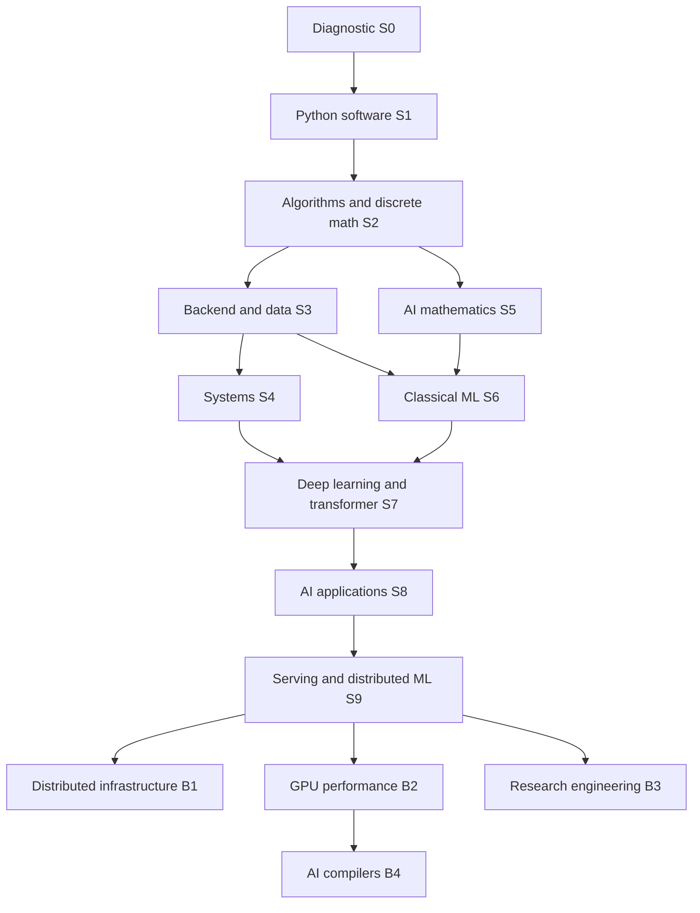

# 2. Complete skills dependency graph

The authoritative stage edges are in `curriculum.json`. This human-readable view expands their subskills. F = foundation; A = advanced common-path exposure; O = optional specialization. A stage delivers bounded competence, not mastery of an entire academic discipline.

Default execution is S0→S9 in numerical order. S5 needs S2, so it may move earlier if desired, but moving it changes order rather than creating extra weekly hours. Employability checks after S3 are not contingent on S5–S9. Full AI application competence here follows ML/deep learning deliberately; backend work is the early career route.

| Competency family | Subskills and direct prerequisite chain | Classification | Implementation evidence |
|---|---|---|---|
| Programming | Control flow → functions/collections → exceptions/I/O → modules/types → dataclasses, generators, context managers → packaging | F S1 | P1 parser, collector and release |
| Programming paradigms | Functions/state → procedural decomposition → OO interfaces/composition → functional transformations/immutability; design patterns only for actual repeated problems | F S1; A S3 | Compare three designs, ADR selects one |
| Correctness | Contracts → tests/fixtures → property and integration tests → fault injection; TDD on a parser and regression fix | F throughout | P1–P13 test evidence |
| Algorithms | Discrete logic, proofs/induction → arrays/maps → sorting/search → trees/heaps → graphs → dynamic programming; asymptotic bounds alongside each | F S2 | P2 inverted index, shortest paths, recurrence |
| Architecture/memory | Binary arithmetic → CPU/cache → C pointers/lifetimes → address spaces → concurrency → profiling | F/A S4 | P4 C buffers, queue and CPU/memory experiments |
| OS/Linux | Processes/file descriptors → virtual memory → threads/locks/conditions → crash recovery | F/A S4 | P4 process pipeline and durable log |
| Networks | Byte streams → framing/TCP → DNS/HTTP/TLS → timeouts/backpressure → distributed failure models | F S3–S4; A S9 | P3 raw HTTP inspection; P4 socket server |
| Storage | Relational schemas/SQL → indexes/transactions → WAL and recovery → replication/consistency → storage-engine trade-offs | F S3; A S4/S9; O B1 | P3 migrations and query plans; P10 storage component |
| Backend/cloud | API contracts → authn/authz → container builds → deployment/CI → monitoring/SLOs → backups/incidents; IAM/network/storage introduced before managed orchestration | F S3; A S9; O B1 | P3 service; P10 deployment and outage drills |
| NoSQL/caching | Data access patterns/consistency → key-value cache → eviction/invalidation → document/key-value versus relational trade-off | F S3; A B1 | P3 cache and written SQL/NoSQL decision; no extra database mandatory |
| Security | Input validation → least privilege → authentication/authorization → secrets/dependencies → threat models → prompt injection/tool boundaries | F S1/S3; A S8 | P3 negative tests; P8 adversarial suite |
| Linear algebra | Vectors/matrices → rank/projections → least squares → QR/SVD/eigenvalues → PCA/embedding geometry | F S5 | P5 solvers and PCA |
| Calculus/optimization | Derivatives → multivariable chain rule/Jacobians → gradients → regularization/SGD → neural optimization | F S5; A S7 | P5 finite differences; P7 backprop |
| Probability/statistics | Counting/conditioning → moments/distributions → estimation/uncertainty → experimental design → calibration/causal limits | F S5–S6 | P5 simulations, P6 confidence intervals |
| Numerical/information theory | Floating point/conditioning → stable reductions → entropy/cross-entropy/KL → loss functions/precision trade-offs | F S5; A S7/S9 | P5 stable softmax; P9 quantization quality |
| Classical ML | Data contracts/EDA → split design → regression/classification → trees/ensembles → clustering → feature pipelines/CV → calibration/drift | F S6 | P6 from-scratch models + deployed pipeline |
| Deep learning | Calculus + ML → autograd/MLP → regularization → CNN/RNN survey → embeddings → attention → transformer → small pretraining | A S7 | P7 gradient engine, classifier labs and small LM |
| LLM applications | APIs/data provenance + model evaluation → retrieval/chunking → vector search → grounded generation → structured outputs → bounded tools/agents | A S8 | P8 evidence search and adversarial tests |
| Model adaptation | Training/splits → supervised fine-tuning → LoRA → preference objective/DPO → synthetic-data auditing | A S8; O deeper B3 | P8 small adapter comparison and toy preference loss |
| Inference | Transformer + systems → batching → KV cache → quantization → scheduling → telemetry/capacity | A S9 | P9 inference benchmark and service |
| Distributed training | Concurrency + gradient math → partitioning → collective sum/all-reduce model → DDP → checkpoint recovery; tensor/pipeline model-parallel trade-offs surveyed after DDP | A S9; O B1/B2 deeper | P9 two-process equivalence test and communication model |
| GPU programming | C/memory + numerics → C++/RAII → GPU memory/threads → CUDA → Triton → fusion/profiling → shape-aware tuning | O B2 | P11 kernel suite |
| Compilers | Parsing/AST survey in S4 → C++/GPU competence → type checking/IR → lowering/JIT → legal rewrites | O B4 | P13 differential-tested compiler |
| Research | Evaluation/statistics + paper reading → implementation parity → protocol → replication → uncertainty → ablations → novel extension | O B3; small exposure S7 | P12 reproducibility package |
| Professional influence | Git/reviews/docs → ADRs → stakeholder requirements → trade-off reviews → mentoring/incident reports → cross-team adoption | F throughout; experiential at senior levels | Every project plus external team/OSS evidence |

Additional essential topics include dataset licensing/provenance, accessibility of user-facing outputs, cost accounting, experiment contamination, software supply-chain hygiene, product requirements, ethical data use, and communicating uncertainty. These are embedded in the projects rather than separate courses.

Diagnostics can exempt an individual module only after an unseen implementation, explanation and delayed retention check pass. Strong mathematical aptitude alone earns no exemption. Deep RL, robotics, multimodal foundation-model pretraining, formal verification, custom networking fabrics and production compiler backends are optional later research domains; they are not prerequisites for first employment.
